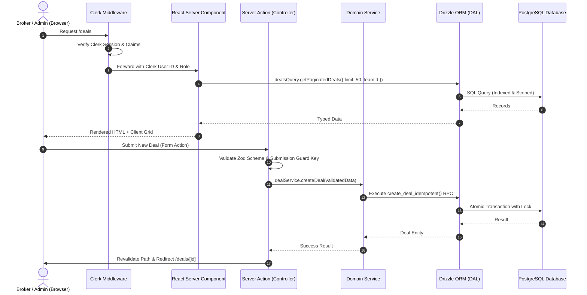
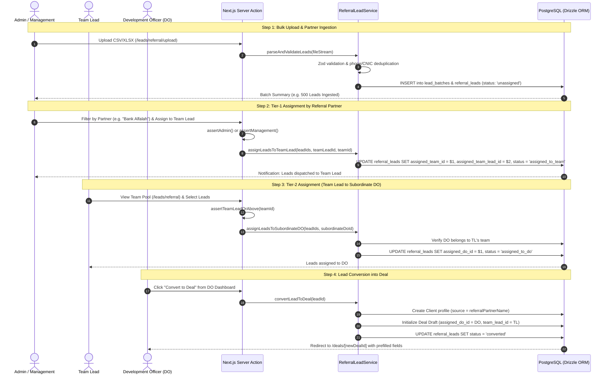
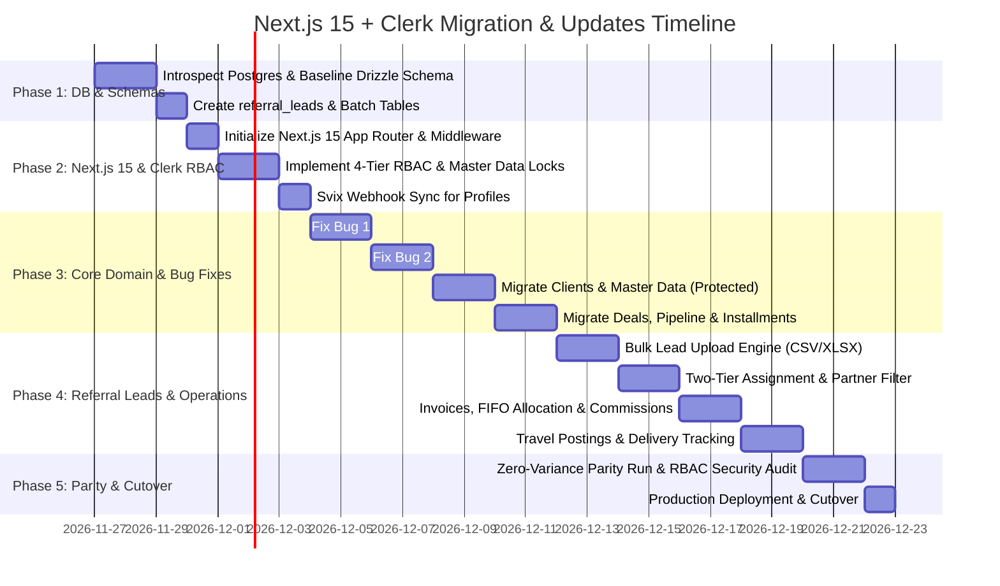

# Insurekar BMS — Next.js 15 Enterprise Conversion & Cleanup Blueprint

> **Executive Summary:** This document outlines the complete architectural rationale, migration path, and cleanup strategy to transform the current Lovable / TanStack Start prototype into a production-grade, high-volume **Next.js 15 (App Router) + Drizzle ORM + Clerk Auth + PostgreSQL** system.

---

## 1. Deep Technical Comparison: Next.js 15 vs. TanStack Start for an Insurance BMS

An Insurance Brokerage Management System (BMS) is not a simple marketing website or generic dashboard; it is a **mission-critical financial ledger, compliance record, and high-volume transaction processing engine**. Below is an in-depth breakdown of why Next.js 15 (App Router) is structurally superior to TanStack Start for this specific platform.

```
┌────────────────────────────────────────────────────────────────────────┐
│                   ARCHITECTURAL COMPARISON MATRIX                     │
├─────────────────────────┬──────────────────────┬───────────────────────┤
│ Dimension               │ TanStack Start       │ Next.js 15 App Router │
│                         │ (Current State)      │ (Target State)        │
├─────────────────────────┼──────────────────────┼───────────────────────┤
│ Framework Lifecycle     │ Alpha / Beta         │ Enterprise Production │
│ Authentication Layer    │ Supabase GoTrue Auth │ Clerk Enterprise Auth │
│ Data Fetching Model     │ Client PostgREST SDK │ React Server Comp.    │
│ Client Memory Footprint │ Heavy JSON hydration │ Lightweight HTML/RSC  │
│ Mutation Execution      │ Client + createServer│ Server Actions        │
│ Database Schema Layer   │ Raw SQL files only   │ Typed Drizzle ORM     │
│ Secrets & Service Role  │ High leakage risk    │ Server-only isolation │
│ Large File Streaming    │ In-browser (hangs)   │ Server stream buffers │
│ Hiring & Ecosystem      │ Niche / Experimental │ Global standard       │
└─────────────────────────┴──────────────────────┴───────────────────────┘
```

### 1.1 Production Maturity & Framework Stability (Alpha/Beta vs. Battle-Tested)
* **The Reality of TanStack Start Today:**
  * TanStack Start is in active **Alpha/Beta** (running `@tanstack/react-start: 1.168.60` alongside `nitro: 3.0.260603-beta`).
  * Framework APIs are actively shifting. During standard build execution, deprecation warnings appear (e.g., `createServerFn().inputValidator()` deprecated in favor of `validator()`).
  * Minor version updates frequently alter routing contracts, Vite plugins, and SSR hydration semantics.
* **Why Next.js is Essential for Insurance:**
  * Next.js 14 and 15 are battle-tested in Fortune 500 banks, healthcare institutions, and enterprise fintech platforms handling millions of daily transactions.
  * In an insurance brokerage handling premium collections, commission disbursements, and policy schedules, framework stability is a non-negotiable requirement.

### 1.2 Data Volume & The Client-Side Waterfall Problem
* **How TanStack Start Operates in This Codebase:**
  * Almost every screen fetches data **directly in the user's browser** via the Supabase client (`supabase.from('deals').select(...)`) inside `useEffect` or client hooks.
  * For 20 test deals, performance is acceptable. But at enterprise scale:
    * **10,000+ client profiles & contacts**
    * **50,000+ policies & endorsements**
    * **100,000+ installment rows & ledger entries**
  * The browser must download multi-megabyte JSON payloads, parse them in JavaScript memory, and execute sorting, filtering, and rollups on the end-user's device. On an agent's or broker's laptop in the field, this causes noticeable UI lag, tab freezes, and high battery consumption.
* **How Next.js Solves This (React Server Components - RSC):**
  * **Zero Client Waterfall:** Server Components run directly on the server next to the PostgreSQL database (connected via connection pooling).
  * Heavy joins (linking Clients $\rightarrow$ Deals $\rightarrow$ Installments $\rightarrow$ Invoices $\rightarrow$ Insurance Companies) execute in sub-millisecond database queries.
  * The browser receives **pre-rendered, lightweight HTML streams** with zero hydration overhead for static UI elements. Raw multi-megabyte JSON datasets never enter client memory.

### 1.3 Financial Ledger Integrity & Transaction Isolation
An insurance BMS is fundamentally an accounting system:
1. Deal submissions must be strictly **idempotent** (preventing accidental duplicate policies).
2. Installment collections must strictly obey **FIFO (First-In, First-Out)** reconciliation rules.
3. Commissions exceeding 45% must trigger auditable approval workflows.
4. Cancellations and refunds must atomically update the accounts ledger and receivables.

| Security & Mutation Dimension | Current TanStack Start Pattern | Next.js Server Actions Pattern |
| :--- | :--- | :--- |
| **Mutation Channel** | Client calls mixed with experimental `createServerFn` | Dedicated **Server Actions** (`"use server"`) |
| **Validation Layer** | Client-heavy Zod parsing that can be bypassed | Strict server boundary: invalid payloads never hit database triggers |
| **Cache Synchronization** | Manual query key invalidation with frequent stale-balance bugs | Automated `revalidatePath('/accounts/receivables')` ensures zero stale cache |
| **Secrets Isolation** | Service role key accidentally bundlable into client chunks | `server-only` package physically prevents server credentials from reaching client bundles |

### 1.4 High-Volume Document & Spreadsheet Streaming (Excel / PDF)
* **Current TanStack Start Approach:**
  * When exporting registers or reports, the browser downloads the entire `xlsx` library (~300KB) and builds the workbook in the browser thread. For registers with 5,000+ rows, the browser tab hangs.
* **Next.js Approach (Streaming Route Handlers):**
  * Dedicated streaming endpoints (`app/api/export/deals/route.ts`) stream database cursor rows directly into an HTTP response stream with `Content-Type: application/vnd.openxmlformats-officedocument.spreadsheetml.sheet`.
  * The file downloads instantaneously with virtually zero RAM consumption on either client or server.

### 1.5 TypeScript Schema Visibility with Drizzle ORM
* **Current Issue:**
  * The file `drizzle/schema.ts` is intentionally an empty placeholder in Lovable. The data model is scattered across 58 raw SQL migration files in `supabase/migrations/` and a 131KB auto-generated TypeScript file.
* **Next.js + Drizzle Solution:**
  * Clean, human-readable TypeScript schema definitions in `src/db/schema/*.ts`.
  * Every table, column type, enum, constraint, and foreign-key relation is explicitly declared, providing autocomplete, compile-time safety, and self-documenting data architecture.

---

## 2. Clerk Authentication Architecture & RBAC

Replacing Supabase Auth with **Clerk (`@clerk/nextjs`)** provides enterprise-grade identity, session management, and role-based access control (RBAC).

```
┌────────────────────────────────────────────────────────┐
│                   Clerk Auth Engine                    │
├────────────────────────────────────────────────────────┤
│  • Edge Middleware Protection (clerkMiddleware)        │
│  • Enterprise RBAC via publicMetadata (admin/mgmt/do)  │
│  • Automatic Session Expiry & Inactivity Timeout       │
│  • Multi-Factor Authentication (MFA / SMS / TOTP)      │
│  • Svix Webhook Sync -> PostgreSQL `profiles` table    │
└──────────────────────────┬─────────────────────────────┘
                           │
             Webhook Sync (Svix HMAC)
                           ▼
┌────────────────────────────────────────────────────────┐
│            PostgreSQL Database (Drizzle ORM)           │
│  `profiles.clerk_user_id` <--> `user_roles.role`       │
└────────────────────────────────────────────────────────┘
```

### 2.1 Role-Based Access Control (RBAC) Specification & Governance Matrix

The BMS enforces a strict 4-tier hierarchical access model:

```
┌────────────────────────────────────────────────────────────────────────┐
│                        HIERARCHICAL ROLE PYRAMID                       │
├────────────────────────────────────────────────────────────────────────┤
│  1. Admin (Super Admin)                                                │
│     └─ Full master control: users, teams, companies, stages, sources   │
│  2. Management (Executive Oversight)                                   │
│     └─ Enterprise analytics, reporting, deals; CANNOT delete master    │
│  3. Team Lead (Sales Supervisor)                                       │
│     └─ Scoped strictly to own team; manages DOs, views team deals/KPIs │
│  4. DO (Development Officer / Sales Agent)                             │
│     └─ Scoped strictly to personal clients, deals, stages & documents  │
└────────────────────────────────────────────────────────────────────────┘
```

#### Detailed Role Permission Matrix

| Capability / Entity | 1. Admin | 2. Management | 3. Team Lead | 4. DO (Sales Agent) |
| :--- | :---: | :---: | :---: | :---: |
| **User & Team Management** | Full (CRUD) | View Only | View Team Members | None |
| **Master Data: Insurance Companies** | Full (CRUD) | View Only *(No Delete)* | View Active Only | View Active Only |
| **Master Data: Insurance Types** | Full (CRUD) | View Only *(No Delete)* | View Active Only | View Active Only |
| **Master Data: Deal Stages** | Full (CRUD) | View Only *(No Delete)* | View Active Only | View Active Only |
| **Master Data: Lead Sources** | Full (CRUD) | View Only *(No Delete)* | View Active Only | View Active Only |
| **Global Dashboards & Income Analytics** | Full Access | Full Access | Scoped to Team | Scoped to Self |
| **Financial Reports & Excel Export** | Full Access | Full Access | Team Deals Only | Own Deals Only |
| **Client Profiles & Contacts** | Full Access | View All | View Team Clients | Create / View Own Only |
| **Deal Creation & Stage Updates** | Full Access | View All | Team Deals (View/Edit) | Create & Update Own Deals |
| **Document Uploads** | Full Access | View All | Team Documents | Own Deal Documents |
| **Manage DO Assignments** | Global | Global | Under Own Team Only | None |
| **Referral Leads: Bulk Upload** | Full Access | Full Access | None | None |
| **Referral Leads: Partner Filter & Assign to TL** | Full Access | Full Access | None | None |
| **Referral Leads: Assign to Under-DOs** | Full Access | Full Access | Own Team DOs Only | View Assigned Leads Only |

#### Clerk Metadata Schema & Assertions
Roles and organizational scopes are stored directly in Clerk's `publicMetadata`:
```json
{
  "role": "team_lead", // "admin" | "management" | "team_lead" | "do"
  "team_id": "00000000-0000-0000-0000-000000000001",
  "is_locked": false
}
```

In Next.js Server Components, Server Actions, and Route Handlers, role guards enforce these invariants at the execution boundary:
```typescript
import { auth } from "@clerk/nextjs/server";

export type UserRole = "admin" | "management" | "team_lead" | "do";

export async function assertAuthenticated() {
  const { sessionClaims, userId } = await auth();
  if (!userId || !sessionClaims) {
    throw new Error("Unauthorized: Authentication required");
  }
  return {
    userId,
    role: (sessionClaims.metadata?.role as UserRole) ?? "do",
    teamId: sessionClaims.metadata?.team_id as string | undefined,
  };
}

/** Enforce Admin-only access (master data deletion, user provisioning) */
export async function assertAdmin() {
  const session = await assertAuthenticated();
  if (session.role !== "admin") {
    throw new Error("Forbidden: Super Admin access required");
  }
  return session;
}

/** Enforce Master Data deletion rule: Management CANNOT delete master data */
export async function assertCanDeleteMasterData() {
  const session = await assertAuthenticated();
  if (session.role !== "admin") {
    throw new Error("Forbidden: Only Super Admins may delete master data (insurance companies, types, stages, sources).");
  }
  return session;
}

/** Enforce Team Lead / Supervisory access (scoped to own team) */
export async function assertTeamLeadOrAbove(targetTeamId?: string) {
  const session = await assertAuthenticated();
  if (session.role === "admin" || session.role === "management") {
    return session;
  }
  if (session.role === "team_lead") {
    if (targetTeamId && session.teamId !== targetTeamId) {
      throw new Error("Forbidden: Team Leads may only access data for their assigned team");
    }
    return session;
  }
  throw new Error("Forbidden: Supervisory access required");
}
```

### 2.2 Edge Protection via Next.js Middleware
```typescript
// src/middleware.ts
import { clerkMiddleware, createRouteMatcher } from "@clerk/nextjs/server";

const isPublicRoute = createRouteMatcher([
  "/sign-in(.*)",
  "/sign-up(.*)",
  "/api/webhooks(.*)",
]);

const isAdminRoute = createRouteMatcher(["/admin(.*)"]);
const isManagementRoute = createRouteMatcher(["/operations/reports(.*)", "/operations/performance(.*)"]);

export default clerkMiddleware(async (auth, req) => {
  if (!isPublicRoute(req)) {
    await auth.protect();
  }
  const { sessionClaims } = await auth();
  const role = sessionClaims?.metadata?.role;

  if (isAdminRoute(req) && role !== "admin") {
    return new Response("Forbidden: Admin access required", { status: 403 });
  }

  if (isManagementRoute(req) && role !== "admin" && role !== "management") {
    return new Response("Forbidden: Management or Admin access required", { status: 403 });
  }
});

export const config = {
  matcher: ["/((?!.*\\..*|_next).*)", "/", "/(api|trpc)(.*)"],
};
```

### 2.3 Closing Clerk-to-Drizzle Security & Sync Traps
* **Mandatory Scoped DAL & Data Visibility:** In Drizzle queries, never fetch raw data without passing the viewer's `VisibilityScope`:
  - **Admin / Management:** Accesses all records (`scope.all = true`).
  - **Team Lead:** Scoped queries dynamically inject `WHERE team_id = :teamId OR team_lead_id = :userId`.
  - **DO:** Scoped queries dynamically inject `WHERE (assigned_do_id = :userId OR created_by = :userId)`.
* **Management Master Data Protection:** Hardcoded policy in database and server action layers prevents `DELETE` operations on `insurance_companies`, `insurance_types`, `deal_stages`, and `lead_sources` if the actor's role is `management`.
* **Never Trust Stale JWT Claims for High-Risk Actions:** Clerk `sessionClaims.metadata.role` can remain cached up to 60 seconds. Use JWT claims for UI routing, but verify `role` and `is_locked` directly against PostgreSQL before executing admin, refund, or approval Server Actions.
* **Defense-in-Depth Beyond `middleware.ts`:** Never treat middleware as the sole auth boundary. Enforce explicit `assertRole()` checks at the entry of every Server Component loader, Server Action, and Route Handler.
* **JIT Upsert for Svix Webhook Race Conditions:** A newly created user can land on `/dashboard` milliseconds before the async Svix webhook inserts their `profiles` row. Pair the webhook with a **Just-in-Time (JIT) idempotent upsert** in the auth helper on first authenticated request.

### 2.4 Flexible Custom Roles, Default-Deny Permissions & Leak-Free Analytics
To replace the rigid 4-value `app_role` enum and eliminate permission leaks observed in production:
* **Dynamic Custom Roles (`roles` + `role_permissions`):** Move beyond 4 fixed roles (`admin`, `management`, `team_lead`, `do`) to a `roles` table (`id`, `slug`, `name`, `data_scope: 'own' | 'team' | 'all'`, `is_system`) and `role_permissions` (`role_id`, `perm_key`, `level`), while preserving per-user overrides (`user_permissions`) and `permission_audit_log`. Real designations (*AVP*, *Head of Ops*, *Regional Sales Manager*, *Corporate Business Manager*, *Assistant Operations*, *Social Media Manager*) each get exact permissions without SQL enum migrations.
* **Remove Legacy `Module Access` Fallback (Default-Deny):** Deprecate `user_module_permissions`. If a permission key is not explicitly granted (`none` by default), access is **blocked** in both the UI and Server Actions/DAL—so toggling off a screen permission can never leak through a coarse module fallback.
* **Enforce `teams.lead_id` Integrity:** Automatically sync `teams.lead_id` whenever a Team Lead is assigned to a team, preventing orphaned team leads from breaking team-scoped queries.
* **Server-Aggregated Analytics & Reports:** Never fetch all `deals` and `policies` to the browser and filter in JavaScript (`_app.analytics.tsx`). Run analytics as React Server Components using PostgreSQL aggregations (`SUM`, `COUNT`, `GROUP BY`) *after* applying `WHERE team_id IN (...)` on the server, so zero out-of-scope records ever leave the database.

### 2.5 Zero-Loss Production User Migration & Invite-Only Onboarding
* **Authoritative Production Environment:** `https://crm.insurekar.pk/` (hosted on Vercel) points to the live production Supabase database (19+ active users, 2 months of live data), which is separate from the outdated Lovable Cloud staging database (`pk-policy-hub.lovable.app`). Always export and migrate from the **Vercel production Supabase project**.
* **Preserve `profiles.id` (UUID) Forever:** 40+ foreign keys across `deals`, `clients`, `invoices`, `commissions`, `payroll`, `teams`, and `documents` reference `profiles.id` (`uuid`). Never replace `profiles.id` with a Clerk string ID; instead add `clerk_user_id TEXT UNIQUE` on `public.profiles`.
* **No Re-Signup for Existing Staff:** Bulk-import existing production users into Clerk via `clerkClient.users.createUser` with `externalId: profile.id` and their role/team metadata (and `passwordHasher: "bcrypt"` if exporting hashes from `auth.users`), storing the returned `clerk_user_id` on `profiles`.
* **Invite-Only Onboarding for New Staff:** Disable public `/sign-up` in Clerk. In `/admin/users`, replace manual password entry with `clerkClient.invitations.createInvitation({ emailAddress, publicMetadata })` so new hires set their own password and optional 2FA.

---

## 3. Recommended Core Services to Strengthen Brokerage Calculations

```
┌──────────────────────────────────────────────────────────────────────────────┐
│                    CORE BROKERAGE CALCULATION STACK                          │
├─────────────────────┬────────────────────────────────┬───────────────────────┤
│ Capability          │ Recommended Service / Library  │ Business Value        │
├─────────────────────┼────────────────────────────────┼───────────────────────┤
│ Financial Precision │ Decimal.js / Dinero.js         │ Zero IEEE float errors│
│ Background Jobs     │ Trigger.dev / Inngest          │ Month-end calculations│
│ Document PDF Engine │ @react-pdf/renderer            │ Debit Notes & Invoices│
│ Audit & Compliance  │ Axiom / Better Stack           │ Regulatory audit trail│
└─────────────────────┴────────────────────────────────┴───────────────────────┘
```

### 3.1 Arbitrary-Precision Financial Math (`Decimal.js` / `Dinero.js`)
* **Problem:** Native JavaScript numbers use binary floating-point (`IEEE 754`). Calculations like `0.1 + 0.2 = 0.30000000000000004` cause fractional rounding discrepancies across thousands of installment splits, causing ledger imbalances during bank audits.
* **Solution:**
  - Integrate `decimal.js` inside Drizzle ORM services and `src/lib/calc.ts` for prorated cancellations and multi-tier commission splits.
  - **Deterministic Remainder Allocation:** Use the **Largest Remainder Method** (or assign residual paisa to the final installment/house share) so split sums always equal the exact parent total. *(Existing `NUMERIC` column types are kept intact during migration to avoid breaking existing views, generated columns, and RPCs.)*
  - **Effective-Dated Tax & Commission Rules:** Move hardcoded rates (`17%` WHT, `9%` marketing tax, `45%` approval threshold) into effective-dated config tables (`effective_from`, `effective_to`, `insurer_id`, `line_of_business`) and **snapshot applied rates** onto each deal and invoice at issuance so future fiscal-year changes never alter historical figures.

### 3.2 Async Background Job & Calculation Engine (`Trigger.dev` or `Inngest`)
* **Problem:** Long-running calculations (month-end commission recalculations across 10,000+ policies, daily installment aging sweeps, replaying FIFO payment allocation) time out on standard web requests.
* **Solution:** Step-based background execution with zero timeouts and automatic step retries.

### 3.3 Immutable Persisted Legal PDFs (`@react-pdf/renderer` + Object Storage)
* **Problem:** Browser-side PDF generation freezes client tabs, and generating legal Debit Notes / Tax Invoices dynamically on every download means future template or letterhead edits alter historical documents.
* **Solution:** Keep draft previews rendered on the fly, but **on final issuance**, generate the PDF once via `@react-pdf/renderer`, store it immutably in private object storage (S3/R2) with a **SHA-256 hash and version number**, and serve the archived file on re-download.

---

## 4. API Resilience & Defensive Engineering (Eliminating "API Killers")

To prevent server crashes, cascading request backlogs, data corruption, and information leakage, the Next.js 15 architecture enforces four non-negotiable defensive engineering patterns:

```
┌────────────────────────────────────────────────────────────────────────┐
│                   DEFENSIVE ARCHITECTURE GUARANTEES                    │
├─────────────────────────┬──────────────────────┬───────────────────────┤
│ Common "API Killer"     │ Vulnerability        │ Next.js 15 Solution   │
├─────────────────────────┼──────────────────────┼───────────────────────┤
│ Raw Database Errors     │ Leaks schema/tables  │ Sanitized error mapper│
│ Stuck External Calls    │ Request pile-up      │ AbortSignal.timeout() │
│ Dirty DB Inputs         │ DB exceptions/crashes│ Strict Zod validation │
│ Fat Controllers         │ Unmaintainable code  │ 4-Tier Layered Arch.  │
└─────────────────────────┴──────────────────────┴───────────────────────┘
```

### 4.1 Sanitized Error Handling (Never Return Raw Database Errors)
* **The Vulnerability in Current Code:**
  - Raw PostgreSQL / PostgREST error messages are directly thrown or surfaced via `toast.error(error.message)` (e.g., `if (error) throw new Error(error.message)` in server functions and client handlers).
  - Exposes internal schema names (`"deals_pkey"`, `current_user_team()`), table column structures, and permission rules to attackers, while providing confusing error strings to users.
* **The Production Solution:**
  - Server Actions catch all database exceptions, log the full raw stack trace to server-side telemetry (e.g., Axiom / Sentry) with an incident reference ID, and return a clean, user-friendly, domain-specific message:
  ```typescript
  export async function safeActionHandler<T>(
    action: () => Promise<T>
  ): Promise<{ data?: T; error?: string }> {
    try {
      const data = await action();
      return { data };
    } catch (err: any) {
      const errorId = crypto.randomUUID();
      console.error(`[Internal Error ${errorId}]:`, err);
      
      // Map known Postgres error codes to friendly messages
      if (err.code === "23505") return { error: "A record with this information already exists." };
      if (err.code === "42501") return { error: "You do not have permission to perform this action." };
      if (err.code === "23503") return { error: "The referenced item (e.g. client, team) no longer exists." };
      
      return { error: `An unexpected error occurred. Please quote Ref: ${errorId.slice(0, 8)} to support.` };
    }
  }
  ```

### 4.2 Enforced Timeouts on All External & Database Calls (Preventing Server Hangs)
* **The Vulnerability in Current Code:**
  - `fetch` calls in Supabase clients have no `signal` or `timeout`.
  - If a downstream service (storage CDN, webhook, payment gateway) hangs or runs slowly, requests pile up in memory, exhausting thread pools and crashing the server runtime.
* **The Production Solution:**
  - Every external network call and database query enforces a strict timeout via `AbortSignal.timeout(ms)`:
  ```typescript
  export async function fetchWithTimeout(
    url: string,
    options: RequestInit = {},
    timeoutMs = 8000
  ) {
    const signal = AbortSignal.timeout(timeoutMs);
    try {
      return await fetch(url, { ...options, signal });
    } catch (err: any) {
      if (err.name === "TimeoutError") {
        throw new Error("Downstream service timed out. Please try again later.");
      }
      throw err;
    }
  }
  ```

### 4.3 Strict Fail-Fast Input Validation with Zod (Never Hit DB with Dirty Data)
* **The Vulnerability in Current Code:**
  - Most routes directly insert raw client state (`supabase.from("clients").insert({ ...payload })` or `as any`), relying only on database constraint failures or triggers.
  - Using `z.number()` for money also introduces IEEE 754 float drift before `Decimal.js` ever runs.
* **The Production Solution:**
  - Zero unvalidated data reaches the database. Validate all currency inputs as **strings** (`z.string().regex(/^\d+(\.\d{1,4})?$/)`) or integer minor units (`BIGINT` paisa/cents) so money never touches a JS `number`:
  ```typescript
  const MoneyStringSchema = z
    .string()
    .regex(/^\d+(\.\d{1,4})?$/, "Invalid currency format")
    .refine((val) => new Decimal(val).gt(0), "Amount must be greater than zero");

  const CreateInvoiceSchema = z.object({
    clientId: z.string().uuid("Invalid client ID"),
    dealId: z.string().uuid("Invalid deal ID"),
    totalAmount: MoneyStringSchema,
    dueDate: z.coerce.date(),
    items: z.array(z.object({
      description: z.string().min(1, "Description required"),
      amount: MoneyStringSchema,
    })).min(1, "At least one line item is required"),
  });
  ```

### 4.4 4-Tier Layered Architecture (Eliminating "God Files" & Fat Controllers)
* **The Vulnerability in Current Code:**
  - Files like `_app.deals.new.tsx` (82 KB) and `_app.deals.$id.tsx` (63 KB) mash UI rendering, state management, direct SQL queries, formulas, and error handling into a single massive file.
* **The Production Solution:**
  - Strict separation of concerns into 4 distinct, maintainable layers:
  ```
  1. Presentation Layer (src/app/ & src/components/)
     └─ Pure UI components, handles visual rendering, forms, and client events.
  2. Action / Controller Layer (src/actions/)
     └─ Mutations only (never use Server Actions for reads/live search; use RSCs or GET Route Handlers).
  3. Domain / Service Layer (src/lib/services/)
     └─ Pure business logic: FIFO payment allocation, commission calculations, tax math.
  4. Data Access Layer (src/db/queries/)
     └─ Drizzle ORM queries, transactions, and database indexing.
  ```

### 4.5 Concurrency, Locking & Transactional Audit Integrity
* **Pessimistic Row Locking (`SELECT ... FOR UPDATE`):** Wrap FIFO allocations, commission payouts, and refunds in `db.transaction()` with `SELECT ... FOR UPDATE` on parent deal/invoice/installment rows so simultaneous clicks cannot double-allocate funds.
* **Optimistic Concurrency Control (`version` column):** Add an integer `version` column to `deals`, `clients`, and `invoices` and enforce `WHERE id = $1 AND version = $2` on updates to prevent silent overwrites.
* **Universal Financial Idempotency:** Extend `UNIQUE idempotency_key` enforcement beyond `create_deal_idempotent()` to receipts, FIFO allocations, refund payouts, debit notes, and commission batches.
* **In-Database Transactional Audit Trail:** Write an append-only `audit_events` row (`actor_id`, `entity_type`, `entity_id`, `before_json`, `after_json`, `reason`, `request_id`) **inside the same PostgreSQL transaction** as every financial or approval mutation so no change can commit without its audit record.

### 4.6 Architectural Fix for Bug #1: Disentangling DO Production vs. Team Lead Supervisory Attribution

#### The Root Cause in Current Architecture:
In the legacy codebase (`PipelineFunnel.tsx`, `_app.dashboard.tsx`, `visibility.ts`), deals are filtered using a conflated boolean clause:
```typescript
// Legacy flawed filter logic
if (d.assigned_do_id !== applied.userId && d.team_lead_id !== applied.userId) return false;
```
Because deals written by a DO store both `assigned_do_id = <DO_ID>` and `team_lead_id = <TL_ID>`, filtering by a Team Lead's user ID inadvertently pulls in **all production generated by their subordinate DOs**, incorrectly displaying it as the Team Lead's personal business. Furthermore, when filtering by DO, supervisory linkages can produce false duplicates or attribution leakage in aggregate reports.

#### The Next.js 15 + Drizzle Resolution Architecture:
1. **Strict Entity Separation in PostgreSQL / Drizzle Schema**:
   - `assigned_do_id (UUID)`: Strictly designates the **Sales Producer / Development Officer** who originated, owned, and closed the policy.
   - `team_id (UUID)` & `team_lead_id (UUID)`: Designates the supervisory reporting branch for organizational rollups and managerial override commissions.
2. **Granular Scoped Data Access Layer (DAL) Query Modes**:
   Instead of a single ambiguous filter, the DAL provides three explicit query scopes:
   ```typescript
   export type ProductionScope = 
     | { type: "do_personal"; doId: string }
     | { type: "team_lead_personal"; teamLeadId: string }
     | { type: "team_subordinate_rollup"; teamLeadId: string; teamId: string }
     | { type: "team_aggregate_total"; teamId: string };

   export function buildProductionFilter(scope: ProductionScope) {
     switch (scope.type) {
       case "do_personal":
         // Returns strictly deals where this DO is the direct sales agent
         return eq(deals.assigned_do_id, scope.doId);

       case "team_lead_personal":
         // Returns deals where the Team Lead personally acted as the originating DO
         return and(
           eq(deals.assigned_do_id, scope.teamLeadId),
           eq(deals.team_lead_id, scope.teamLeadId)
         );

       case "team_subordinate_rollup":
         // Returns deals closed by team members under this TL (excluding TL personal sales)
         return and(
           eq(deals.team_lead_id, scope.teamLeadId),
           ne(deals.assigned_do_id, scope.teamLeadId)
         );

       case "team_aggregate_total":
         // Full branch volume
         return eq(deals.team_id, scope.teamId);
     }
   }
   ```
3. **UI Filter Granularity**:
   On the Dashboard and Pipeline Funnel, the user selector provides clear, distinct options:
   - *"Team Total (All Members)"*
   - *"Team Members Only (DO Production Breakdown)"*
   - *"My Personal Production (Direct Sales as Producer)"*

---

### 4.7 Architectural Fix for Bug #2: Mathematical Reconciliation & Parity Between Won Business & Tagged Premium

#### The Root Cause in Current Architecture:
In the legacy codebase, "Won Business" and "Tagged Business" diverge due to three fundamental flaws:
1. **Divergent Metric Definitions**: In `PipelineFunnel.tsx`, `wonValue` returned `gross_premium` for standard deals, but returned `tagged_premium` for custom installment plans. In `_app.dashboard.tsx`, cards compared Gross Premium directly against Tagged Premium without clarifying the multiplier.
2. **Recognition Date Asynchrony**: Single-payment deals recognized won status on `payment_receive_date` or `created_at`, while installment deals recognized partial won status on individual installment `paid_date`s. Filtering by a date range counted a deal as "Won" in deal-count cards while installment sums were partially recognized in financial cards.
3. **Floating-point & Dynamic Settings Drift**: Tagged Premium depends on `base_percentage` (`13%` default). Historical deals without hard-snapshotted base percentages recalculated dynamically when global settings changed, breaking parity with historical reports.

#### The Next.js 15 + Drizzle Resolution Architecture:
1. **Rigorous Domain Metric Definitions**:
   - **Won Gross Premium**: $\sum \text{gross\_premium}$ of all deals where `deal_stages.is_won = true` (or paid installment gross amounts).
   - **Won Net Premium**: $\sum \text{net\_premium}$ of won policies.
   - **Tagged Premium (Base Brokerage Revenue)**: Defined by invariant law:
     $$\text{Tagged Premium} = \text{Net Premium} \times \left(\frac{\text{snapshot\_base\_percentage}}{100}\right)$$
2. **Immutable Snapshotting at Deal Creation**:
   Every deal record permanently snapshots `snapshot_base_percentage` at the time of creation. Global changes to `app_settings` apply only to future deals, never altering historical tagged premium calculations.
3. **Centralized Calculation Engine (`src/lib/services/financial-metrics.service.ts`)**:
   All cards, funnels, and exports call a single, unified financial engine powered by `Decimal.js`:
   ```typescript
   import Decimal from "decimal.js";

   export interface FinancialBreakdown {
     grossPremium: string;
     netPremium: string;
     taggedPremium: string;
     totalIncome: string;
   }

   export function computeDealMetrics(
     deals: Array<{
       netPremium: string;
       grossPremium: string;
       basePercentage: string;
       commissionPercentage: string;
     }>
   ): FinancialBreakdown {
     let gross = new Decimal(0);
     let net = new Decimal(0);
     let tagged = new Decimal(0);

     for (const d of deals) {
       const dGross = new Decimal(d.grossPremium || 0);
       const dNet = new Decimal(d.netPremium || 0);
       const basePct = new Decimal(d.basePercentage || 13).div(100);

       gross = gross.plus(dGross);
       net = net.plus(dNet);
       tagged = tagged.plus(dNet.times(basePct));
     }

     return {
       grossPremium: gross.toFixed(2),
       netPremium: net.toFixed(2),
       taggedPremium: tagged.toFixed(2),
       totalIncome: tagged.toFixed(2), // Synchronized base income
     };
   }
   ```
4. **Automated Mathematical Parity Suite**:
   A continuous integration test suite runs nightly, asserting that $\text{Tagged Premium}$ matches $\text{Net Premium} \times \text{Base \%}$ across 100% of won records with `0.00` allowable variance.

### 4.8 UI/UX Standard: Searchable `<UserCombobox />` Across All Dropdowns
* **Current Issue:** User selectors across `/permissions`, `/deals`, `/leads/unassigned`, `/teams`, and `/tasks` use plain `<Select>` lists, making it slow and error-prone to pick from 19+ staff members.
* **Solution:** Replace every user, client, and team `<Select>` with a shared searchable **`<UserCombobox />`** built on Radix `Popover` + `cmdk` (already in `package.json`), filtering instantaneously by **Name, Email, Designation, and Team**—and automatically scoping selectable users (e.g., Team Leads only see DOs inside their own team).

---

## 5. Target Directory & Clean Modular Structure

```
insurekar-bms/
├── src/
│   ├── app/                                 # Next.js 15 App Router (Presentation)
│   │   ├── (auth)/                          # Clerk authentication routes
│   │   │   ├── sign-in/[[...sign-in]]/page.tsx
│   │   │   ├── sign-up/[[...sign-up]]/page.tsx
│   │   │   └── layout.tsx
│   │   ├── (dashboard)/                     # Protected routes (AppShell + Guards)
│   │   │   ├── layout.tsx                   # Auth verification, Sidebar, Header
│   │   │   ├── page.tsx                     # Dashboard KPIs & Charts
│   │   │   ├── clients/
│   │   │   │   ├── page.tsx                 # Paginated Clients Table
│   │   │   │   └── [id]/page.tsx            # Client details & linked deals
│   │   │   ├── deals/
│   │   │   │   ├── page.tsx                 # Deals List View (Server Paginated)
│   │   │   │   ├── new/page.tsx             # New Deal Creation (Idempotent Guard)
│   │   │   │   ├── [id]/page.tsx            # Deal Master Record & Editor
│   │   │   │   └── pipeline/page.tsx        # Pipeline Kanban & Funnel
│   │   │   ├── leads/                       # Referral Leads Management Module
│   │   │   │   ├── referral/page.tsx        # Referral Leads List & Partner Filter
│   │   │   │   ├── referral/upload/page.tsx # Bulk CSV/Excel Upload
│   │   │   │   └── unassigned/page.tsx      # Unassigned Leads Management
│   │   │   ├── accounts/
│   │   │   │   ├── invoices/page.tsx
│   │   │   │   ├── receivables/page.tsx
│   │   │   │   ├── payables/page.tsx
│   │   │   │   ├── installments/page.tsx
│   │   │   │   ├── payments/page.tsx
│   │   │   │   ├── tax/page.tsx
│   │   │   │   └── approvals/page.tsx
│   │   │   ├── operations/
│   │   │   │   ├── commissions/page.tsx
│   │   │   │   ├── refunds/page.tsx
│   │   │   │   ├── underwriting/
│   │   │   │   │   ├── page.tsx
│   │   │   │   │   ├── new/page.tsx
│   │   │   │   │   └── [id]/page.tsx
│   │   │   │   ├── travel/page.tsx          # Bulk policies & delivery tracking
│   │   │   │   ├── dispatch/page.tsx
│   │   │   │   └── payroll/page.tsx
│   │   │   ├── tickets/
│   │   │   │   ├── page.tsx
│   │   │   │   └── [id]/page.tsx
│   │   │   └── admin/                       # Super Admin only
│   │   │       ├── users/page.tsx
│   │   │       ├── teams/page.tsx
│   │   │       ├── master-data/page.tsx     # Insurers, stages, sources
│   │   │       └── targets/page.tsx
│   │   ├── api/                             # Streaming endpoints & webhooks
│   │   │   ├── webhooks/clerk/route.ts      # Svix Webhook user sync
│   │   │   ├── export/deals/route.ts        # Server-side Excel streaming
│   │   │   ├── documents/invoice/[id]/route.ts # Server-side PDF generation
│   │   │   └── leads/upload/route.ts        # Streaming bulk lead upload
│   │   ├── globals.css
│   │   └── layout.tsx                       # Root layout (<ClerkProvider>, Fonts, Toaster)
│   │
│   ├── actions/                             # Layer 2: Server Actions (Controller Layer)
│   │   ├── deals.actions.ts                 # Create (idempotent), update, correct
│   │   ├── clients.actions.ts               # Create, update (delta-only)
│   │   ├── leads.actions.ts                 # Bulk upload, partner filter, assign to TL, assign to DO
│   │   ├── accounts.actions.ts              # Invoicing, receipts, payment allocation
│   │   ├── operations.actions.ts            # Commission approval, refunds, travel
│   │   └── admin.actions.ts                 # User provisioning, lock, team assignment
│   │
│   ├── lib/                                 # Layer 3: Domain & Services Layer
│   │   ├── services/
│   │   │   ├── deal.service.ts              # Idempotent deal workflows
│   │   │   ├── referral-lead.service.ts     # Ingestion, validation, 2-tier delegation
│   │   │   ├── accounting.service.ts        # FIFO allocation & invoice balances
│   │   │   ├── financial-metrics.service.ts # Won vs Tagged calculation parity
│   │   │   └── commission.service.ts        # 45% approval & tax deductions
│   │   ├── calc.ts                          # Financial calculations (100% preserved)
│   │   ├── deal-record-fields.ts            # Explicit catalog for deal corrections
│   │   ├── deal-instalment-rollup.ts        # Rolled-up sums and balances
│   │   ├── permissions.ts                   # Role permission matrices
│   │   └── format.ts                        # Currency, date, and text formatters
│   │
│   ├── db/                                  # Layer 4: Data Access Layer (Drizzle ORM)
│   │   ├── index.ts                         # Pooled PostgreSQL client
│   │   ├── schema/                          # Explicit TypeScript Schemas
│   │   │   ├── auth.ts                      # Profiles (linked to Clerk ID), roles
│   │   │   ├── clients.ts                   # Clients & client contacts
│   │   │   ├── deals.ts                     # Deals, stages, custom installments
│   │   │   ├── leads.ts                     # Referral leads, batches, assignment logs
│   │   │   ├── accounts.ts                  # Invoices, payables, receivables, ledger
│   │   │   ├── operations.ts                # Travel postings, refunds, underwriting
│   │   │   ├── master.ts                    # Companies, insurance types, sources
│   │   │   └── index.ts                     # Schema barrel export
│   │   ├── queries/                         # Optimized SQL queries & indexes
│   │   └── relations.ts                     # Full foreign-key relational graph
│   │
│   ├── jobs/                                # Background Workers (Trigger.dev)
│   │   ├── monthly-commissions.job.ts       # Nightly & month-end commission batch runs
│   │   ├── overdue-installments.job.ts      # Daily overdue checks & aging sweeps
│   │   └── lead-assignment-digest.job.ts    # Unassigned leads reminder & SLA escalations
│   │
│   ├── components/                          # UI Component Tree
│   │   ├── ui/                              # shadcn/ui components (Radix + Tailwind)
│   │   ├── shared/                          # PageHeader, MoneyInput, DateField
│   │   ├── deals/                           # DealAmountTable, DealCustomInstalments
│   │   ├── leads/                           # ReferralBulkUploadModal, PartnerFilterSelect
│   │   ├── accounts/                        # InvoiceTable, PaymentAllocationModal
│   │   └── layout/                          # AppShell, Sidebar, Header, UserMenu
│   │
│   └── middleware.ts                        # Clerk edge protection & route matchers
```

---

## 6. How Features Will Work in Next.js + Clerk

### 6.1 Deal Lifecycle & Server Action Execution Flow



### 6.2 Referral Leads Pipeline Architecture: Bulk Ingestion & Two-Tier Delegation

The Referral Leads module enables high-volume partner acquisition, streamlined lead processing, and auditable accountability across management tiers.

```
┌────────────────────────────────────────────────────────────────────────┐
│               TWO-TIER REFERRAL LEAD DELEGATION PIPELINE               │
├────────────────────────────────────────────────────────────────────────┤
│  STEP 1: Bulk Upload (Admin / Management)                              │
│          Upload multi-thousand lead CSV/XLSX with partner attribution  │
│                                                                        │
│  STEP 2: Partner Filter & Tier-1 Assignment (Admin / Management)       │
│          Filter unassigned pool by Referral Partner -> Assign to TL   │
│                                                                        │
│  STEP 3: Tier-2 Assignment (Team Lead)                                 │
│          Team Lead reviews team pool -> Assigns to subordinate DO      │
│                                                                        │
│  STEP 4: Conversion & Deal Creation (DO)                               │
│          DO contacts lead -> 1-Click Convert to Client + Deal Record   │
└────────────────────────────────────────────────────────────────────────┘
```

#### 1. Drizzle ORM Schema Definition (`src/db/schema/leads.ts`)
```typescript
import { pgTable, uuid, text, timestamp, numeric, varchar, integer, index } from "drizzle-orm/pg-core";
import { profiles, teams } from "./auth";
import { insuranceTypes } from "./master";

export const leadBatches = pgTable("lead_batches", {
  id: uuid("id").primaryKey().defaultRandom(),
  batchNumber: varchar("batch_number", { length: 50 }).notNull().unique(),
  uploadedBy: text("uploaded_by").notNull(), // Clerk User ID
  totalRecords: integer("total_records").notNull(),
  validRecords: integer("valid_records").notNull(),
  failedRecords: integer("failed_records").notNull().default(0),
  fileName: text("file_name").notNull(),
  createdAt: timestamp("created_at", { withTimezone: true }).defaultNow().notNull(),
});

export const referralLeads = pgTable("referral_leads", {
  id: uuid("id").primaryKey().defaultRandom(),
  batchId: uuid("batch_id").references(() => leadBatches.id),
  referralPartnerName: varchar("referral_partner_name", { length: 255 }).notNull(),
  
  // Client Contact Details
  clientName: varchar("client_name", { length: 255 }).notNull(),
  phone: varchar("phone", { length: 50 }).notNull(),
  email: varchar("email", { length: 255 }),
  nationalIdCnic: varchar("national_id_cnic", { length: 50 }),
  
  // Insurance Context
  insuranceTypeId: uuid("insurance_type_id").references(() => insuranceTypes.id),
  estimatedPremium: numeric("estimated_premium", { precision: 14, scale: 2 }),
  notes: text("notes"),
  
  // Status & Lifecycle
  status: varchar("status", { length: 50 })
    .notNull()
    .default("unassigned"), // 'unassigned' | 'assigned_to_team' | 'assigned_to_do' | 'converted' | 'discarded'

  // Two-Tier Hierarchical Assignment
  assignedTeamId: uuid("assigned_team_id").references(() => teams.id),
  assignedTeamLeadId: uuid("assigned_team_lead_id").references(() => profiles.id),
  assignedDoId: uuid("assigned_do_id").references(() => profiles.id),
  
  // Audit Trail
  assignedByAdminId: text("assigned_by_admin_id"),
  assignedByTlId: text("assigned_by_tl_id"),
  convertedDealId: uuid("converted_deal_id"),
  convertedClientId: uuid("converted_client_id"),
  
  createdAt: timestamp("created_at", { withTimezone: true }).defaultNow().notNull(),
  updatedAt: timestamp("updated_at", { withTimezone: true }).defaultNow().notNull(),
}, (table) => ({
  partnerIdx: index("idx_referral_partner").on(table.referralPartnerName),
  statusIdx: index("idx_referral_status").on(table.status),
  teamLeadIdx: index("idx_referral_team_lead").on(table.assignedTeamLeadId),
  assignedDoIdx: index("idx_referral_do").on(table.assignedDoId),
  phoneIdx: index("idx_referral_phone").on(table.phone),
}));
```

#### 2. Sequence Diagram: Bulk Ingestion & Two-Tier Assignment Flow



#### 3. Core Functional Capabilities
* **Bulk Ingestion Route Handler & Action**:
  - Accepts `.csv` and `.xlsx` multipart file uploads up to 50MB.
  - Streaming line-by-line parser using `fast-csv` or `xlsx` stream buffers on the server.
  - Normalizes Pakistani phone numbers (`03xx-xxxxxxx` $\rightarrow$ `+923xxxxxxxxx`) and CNICs (`xxxxx-xxxxxxx-x`).
  - Flags duplicate leads against active database records without halting the entire batch.
* **Partner Filter & Batch Assignment (Admin & Management Only)**:
  - High-performance dropdown pulling `SELECT DISTINCT referral_partner_name FROM referral_leads`.
  - Filter by multiple partners, date ranges, and upload batches.
  - Select All / Paginated Checkbox mechanism allows assigning hundreds of leads in a single atomic Server Action.
* **Team Lead Supervisory Queue**:
  - Scoped to `assigned_team_id = session.teamId`.
  - Team Lead can inspect lead details, view notes, and delegate to active DOs in their team roster with balanced workload distribution.
* **Audit Trail & Lead History**:
  - Tracks timestamp and user ID for every state transition: upload $\rightarrow$ assigned to TL $\rightarrow$ assigned to DO $\rightarrow$ converted to Deal.

---

## 7. Code Cleanup & De-cluttering Strategy

### What Gets Deleted / Removed:
1. **Lovable Wrappers**:
   - Delete `@lovable.dev/cloud-auth-js`
   - Delete `@lovable.dev/vite-tanstack-config`
   - Delete `src/lib/lovable-error-reporting.ts`
2. **Supabase Client Auth Redundancies**:
   - Delete `src/lib/auth.tsx` (Replaced by Clerk's `useAuth()`, `useUser()`, and `<ClerkProvider>`)
   - Delete `src/components/SessionTimeout.tsx` (Handled natively by Clerk)
   - Delete `src/integrations/supabase/previewAuthStorage.ts`
3. **TanStack Start & Nitro Engine**:
   - Delete `nitro`, `@tanstack/react-start`, `@tanstack/router-plugin`, `@tanstack/react-router`
   - Delete `vite.config.ts`, `bun.lock`, `bunfig.toml`
   - Delete flat route files in `src/routes/*`
4. **Obsolete Configs**:
   - Delete `components.json` (replaced with standard Next.js shadcn config)
   - Clean up `package.json` to remove 25+ unused development and bundler packages.

### What Gets Reused & Preserved (Zero Loss of Work):
1. **Domain Logic (`src/lib/`)**:
   - `src/lib/calc.ts` (Commission & financial formulas)
   - `src/lib/deal-record-fields.ts` (Validation & field schemas)
   - `src/lib/deal-instalment-rollup.ts`
   - `src/lib/format.ts`
   - `src/lib/permissions.ts`
2. **UI Component Primitives (`src/components/ui/`)**:
   - All 40+ Radix/Tailwind components (`button.tsx`, `dialog.tsx`, `input.tsx`, `table.tsx`, `select.tsx`, etc.) are 100% compatible with Next.js 15.
3. **Business Components**:
   - `DealAmountTable.tsx`, `DealCustomInstalments.tsx`, `MoneyInput.tsx`, `DateField.tsx`, `PipelineKanban.tsx` transfer directly to Next.js Client Components (`"use client"`).
4. **PostgreSQL Database**:
   - All 58 migrations, tables, triggers, RPC functions, and accounting triggers remain completely preserved.

---

## 8. High-Volume Scalability Blueprint

To ensure the platform seamlessly handles thousands of clients, policies, and transactions:

### 1. Database Connection Pooling & Timeouts
- Next.js connects through PostgreSQL's **Supavisor / PgBouncer Transaction Pooler** (Port `6543`).
- **Disable Prepared Statements:** Port `6543` transaction pooling breaks with `postgres.js` default prepared statements—explicitly configure `postgres(url, { prepare: false })`.
- **Enforce DB-Level Timeouts:** Set Postgres `statement_timeout` (e.g., `10s`) and `lock_timeout` (e.g., `3s`) alongside HTTP `AbortSignal.timeout()` so stalled locks or runaway queries cannot pile up.

### 2. Hybrid Pagination Strategy (Keyset Cursor + Bounded Offset)
- No table loads unfiltered datasets into the browser.
- **Cursor (Keyset) Pagination for High-Volume Lists:** Use composite keyset pagination on `(created_at DESC, id DESC)` for `deals`, `invoices`, `deal_installments`, and `audit_events` so performance stays constant across 100,000+ rows.
- **Bounded `OFFSET` Only Where Required:** Reserve `OFFSET` strictly for small/medium admin tables where users explicitly need numbered page jumps.
  ```typescript
  // Keyset pagination for high-volume deals/ledgers
  const records = await db.query.deals.findMany({
    where: and(
      eq(deals.team_id, userTeamId),
      cursor ? or(
        lt(deals.created_at, cursor.createdAt),
        and(eq(deals.created_at, cursor.createdAt), lt(deals.id, cursor.id))
      ) : undefined
    ),
    limit: 50,
    orderBy: [desc(deals.created_at), desc(deals.id)],
  });
  ```

### 3. High-Performance Database Indexing Strategy (Sub-Millisecond Fetching at Scale)

In a high-volume brokerage with 100,000+ policies, installments, and receipts, standard sequential table scans will freeze the database and cause query timeouts. We will implement four targeted categories of PostgreSQL indexes to ensure sub-millisecond data fetching:

#### A. Compound B-Tree Indexes (Multi-Column Query Optimization)
Matches the exact filter-and-sort patterns used across the BMS dashboards:
* **`deals(team_id, created_at DESC)`**: Instant DO/Team filtered deal listings sorted newest-first without in-memory sorting.
* **`deals(client_id, stage_id)`**: Instant retrieval of all won/active policies for a specific client profile.
* **`deal_installments(deal_id, status, due_date ASC)`**: Fast retrieval of unpaid installments for receipt allocations.
* **`invoices(client_id, status, due_date ASC)`**: Immediate loading of overdue client statements for accounts receivable.
* **`travel_posting_rows(posting_id, commission_approval)`**: Sub-millisecond loading of travel batches with pending management approvals.

#### B. Partial / Filtered Indexes (Zero Overhead for Historical Data)
Partial indexes index *only active or pending rows*, keeping index sizes tiny (kilobytes instead of gigabytes) and queries ultra-fast:
```sql
-- Indexes ONLY pending/unpaid installments (ignoring millions of historical paid rows)
CREATE INDEX idx_installments_pending ON deal_installments (due_date ASC)
WHERE status IN ('pending', 'partial', 'overdue');

-- Indexes ONLY policies requiring management commission approval (>45%)
CREATE INDEX idx_travel_pending_approval ON travel_posting_rows (created_at DESC)
WHERE commission_approval = 'pending';

-- Indexes ONLY open tickets for real-time SLA warning dashboards
CREATE INDEX idx_tickets_active ON tickets (team_id, priority, created_at DESC)
WHERE status != 'closed';
```

#### C. Foreign Key Covering Indexes (Eliminating Slow Table Joins)
PostgreSQL does not automatically index foreign key columns. Unindexed foreign keys cause full sequential table scans on parent-child joins:
* `idx_deals_lead_source`: `deals(lead_source_id)`
* `idx_deals_insurance_company`: `deals(insurance_company_id)`
* `idx_deals_insurance_type`: `deals(insurance_type_id)`
* `idx_deal_docs_deal`: `deal_documents(deal_id)`
* `idx_refund_remarks_refund`: `refund_remarks(refund_id)`

#### D. Trigram / GIN Search Indexes (Instant Client & Policy Search)
A multi-column `gin_trgm_ops` index performs poorly on `OR` search predicates. Instead, use a single stored generated `search_text` column indexed once:
```sql
CREATE EXTENSION IF NOT EXISTS pg_trgm;

ALTER TABLE clients
ADD COLUMN search_text TEXT GENERATED ALWAYS AS (
  coalesce(name, '') || ' ' || coalesce(national_id, '') || ' ' || coalesce(phone, '')
) STORED;

-- Instant search by Client Name, CNIC / National ID, or Phone number
CREATE INDEX idx_clients_search_trgm
ON clients USING gin (search_text gin_trgm_ops);

-- Instant search by Policy Number or Tracking ID
CREATE INDEX idx_deals_policy_no_trgm ON deals 
USING gin (policy_number gin_trgm_ops);
```

### 4. Schema Migration Safety (Protecting Existing Triggers & RLS)
- **Never run `drizzle-kit push`** against a database containing the 58 existing migrations, custom PostgreSQL triggers, RLS policies, and RPCs—it can drop or desync unmanaged objects.
- Baseline the Drizzle schema cleanly, use `drizzle-kit generate` with manual SQL review, and keep complex accounting RPCs versioned in explicit SQL migrations.

---

## 9. Phased Execution Roadmap

### Phase Breakdown

#### Phase 1: Database & Schemas (Nov 27 – Nov 29)
* Introspect existing PostgreSQL schema and baseline Drizzle ORM definitions in `src/db/schema/`.
* Adapt `profiles` table to bridge Clerk user strings (`user_xxx`) with database UUIDs.
* Create migration for `referral_leads` and `lead_batches` tables with compound indexes on `(referral_partner_name, status, assigned_team_lead_id)`.
* Implement compound indexes for DO and Team Lead attribution: `idx_deals_assigned_do` and `idx_deals_team_lead`.

#### Phase 2: Next.js 15 App Router & Clerk RBAC Setup (Nov 30 – Dec 03)
* Initialize Next.js 15 App Router structure with React Server Components.
* Configure `@clerk/nextjs` with Edge Middleware protection and public metadata sync.
* Implement the 4-tier Role Enforcement Matrix:
  - **Admin**: Full master data CRUD, user management, and global reports.
  - **Management**: Global view of all deals/dashboards/reports; **strict block on deleting master data**.
  - **Team Lead**: Strictly scoped to assigned team; DO supervision and team deals.
  - **DO**: Strictly scoped to creating clients, creating/updating own deals, uploading documents.
* Set up Svix webhook listener for idempotent profile synchronization.

#### Phase 3: Core Domain Migration & Bug Resolution (Dec 04 – Dec 11)
* **Resolve Bug #1 (DO vs. Team Lead Business Attribution)**:
  - Implement `buildProductionFilter()` in the Data Access Layer to decouple direct producer sales (`assigned_do_id`) from supervisory oversight (`team_lead_id`).
  - Update Dashboard and Funnel filters to offer explicit toggles: "My Direct Production" vs. "Team Member Production".
* **Resolve Bug #2 (Won Business vs. Tagged Premium Mathematical Parity)**:
  - Centralize all financial calculations in `src/lib/services/financial-metrics.service.ts` using `Decimal.js`.
  - Snapshot `base_percentage` immutably on deal creation.
  - Enforce uniform recognition criteria across single-payment and custom installment deals.
* Port AppShell, Sidebar, Header, and Master Data pages.
* Port Deal Creation with synchronous guard key and idempotent RPC invocation.

#### Phase 4: Referral Leads Module & Operations (Dec 12 – Dec 19)
* **Referral Leads Bulk Upload & Ingestion**:
  - Implement streaming multipart CSV/XLSX file ingestion in `src/app/api/leads/upload/route.ts`.
  - Enforce Zod validation and phone number/CNIC deduplication.
* **Two-Tier Hierarchical Assignment**:
  - Tier 1: Admin & Management interface to filter unassigned leads by Referral Partner Name and assign in bulk to Team Leads.
  - Tier 2: Team Lead interface to review assigned pool and delegate leads to subordinate DOs.
  - DO 1-Click Conversion: Action to convert assigned lead directly into Client + Deal.
* Port Invoices, Accounts Receivable, FIFO payment allocation, Travel Postings, and Commission Approvals.

#### Phase 5: Verification & Zero-Variance Cutover Gate (Dec 20 – Dec 23)
* **Financial Parity Gate**: Run automated verification asserting `0.00` variance across 100% of historical deal balances, installment statuses, and tagged figures.
* **RBAC Penetration Testing**: Verify that Management cannot delete master data, Team Leads cannot access outside teams, and DOs cannot read other agents' deals.
* **Performance Benchmark**: Verify sub-100ms response times on paginated deals and instantaneous Excel streaming.
* Production cutover and DNS switch.

### Post-Migration Roadmap (Phase 6 — Domain Upgrades After Cutover)
To avoid mixing a framework port with a core-accounting schema rewrite, the following major domain upgrades are scheduled *after* Next.js + Clerk cutover is verified:
1. Immutable double-entry general ledger (`journal_entries` + `ledger_lines`).
2. Versioned policy endorsements (`parent_policy_id` + temporal snapshots).
3. Insurer Bordereaux reconciliation & Unallocated Cash (Suspense) account.


