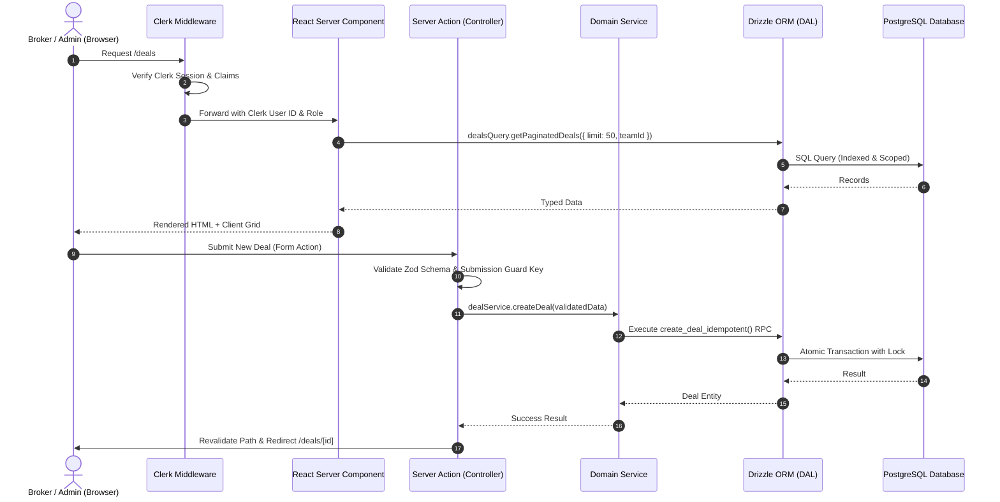
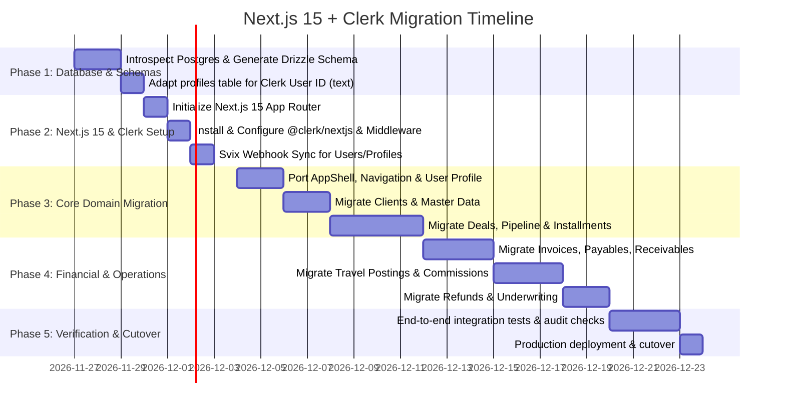

# Insurekar BMS — Next.js 15 Enterprise Conversion & Cleanup Blueprint

> **Executive Summary:** This document outlines the complete architectural rationale, migration path, and cleanup strategy to transform the current Lovable / TanStack Start prototype into a production-grade, high-volume **Next.js 15 (App Router) + Drizzle ORM + Clerk Auth + PostgreSQL** system.

---

## 1. Deep Technical Comparison: Next.js 15 vs. TanStack Start for an Insurance BMS

An Insurance Brokerage Management System (BMS) is not a simple marketing website or generic dashboard; it is a **mission-critical financial ledger, compliance record, and high-volume transaction processing engine**. Below is an in-depth breakdown of why Next.js 15 (App Router) is structurally superior to TanStack Start for this specific platform.

```
┌────────────────────────────────────────────────────────────────────────┐
│                   ARCHITECTURAL COMPARISON MATRIX                     │
├─────────────────────────┬──────────────────────┬───────────────────────┤
│ Dimension               │ TanStack Start       │ Next.js 15 App Router │
│                         │ (Current State)      │ (Target State)        │
├─────────────────────────┼──────────────────────┼───────────────────────┤
│ Framework Lifecycle     │ Alpha / Beta         │ Enterprise Production │
│ Authentication Layer    │ Supabase GoTrue Auth │ Clerk Enterprise Auth │
│ Data Fetching Model     │ Client PostgREST SDK │ React Server Comp.    │
│ Client Memory Footprint │ Heavy JSON hydration │ Lightweight HTML/RSC  │
│ Mutation Execution      │ Client + createServer│ Server Actions        │
│ Database Schema Layer   │ Raw SQL files only   │ Typed Drizzle ORM     │
│ Secrets & Service Role  │ High leakage risk    │ Server-only isolation │
│ Large File Streaming    │ In-browser (hangs)   │ Server stream buffers │
│ Hiring & Ecosystem      │ Niche / Experimental │ Global standard       │
└─────────────────────────┴──────────────────────┴───────────────────────┘
```

### 1.1 Production Maturity & Framework Stability (Alpha/Beta vs. Battle-Tested)
* **The Reality of TanStack Start Today:**
  * TanStack Start is in active **Alpha/Beta** (running `@tanstack/react-start: 1.168.60` alongside `nitro: 3.0.260603-beta`).
  * Framework APIs are actively shifting. During standard build execution, deprecation warnings appear (e.g., `createServerFn().inputValidator()` deprecated in favor of `validator()`).
  * Minor version updates frequently alter routing contracts, Vite plugins, and SSR hydration semantics.
* **Why Next.js is Essential for Insurance:**
  * Next.js 14 and 15 are battle-tested in Fortune 500 banks, healthcare institutions, and enterprise fintech platforms handling millions of daily transactions.
  * In an insurance brokerage handling premium collections, commission disbursements, and policy schedules, framework stability is a non-negotiable requirement.

### 1.2 Data Volume & The Client-Side Waterfall Problem
* **How TanStack Start Operates in This Codebase:**
  * Almost every screen fetches data **directly in the user's browser** via the Supabase client (`supabase.from('deals').select(...)`) inside `useEffect` or client hooks.
  * For 20 test deals, performance is acceptable. But at enterprise scale:
    * **10,000+ client profiles & contacts**
    * **50,000+ policies & endorsements**
    * **100,000+ installment rows & ledger entries**
  * The browser must download multi-megabyte JSON payloads, parse them in JavaScript memory, and execute sorting, filtering, and rollups on the end-user's device. On an agent's or broker's laptop in the field, this causes noticeable UI lag, tab freezes, and high battery consumption.
* **How Next.js Solves This (React Server Components - RSC):**
  * **Zero Client Waterfall:** Server Components run directly on the server next to the PostgreSQL database (connected via connection pooling).
  * Heavy joins (linking Clients $\rightarrow$ Deals $\rightarrow$ Installments $\rightarrow$ Invoices $\rightarrow$ Insurance Companies) execute in sub-millisecond database queries.
  * The browser receives **pre-rendered, lightweight HTML streams** with zero hydration overhead for static UI elements. Raw multi-megabyte JSON datasets never enter client memory.

### 1.3 Financial Ledger Integrity & Transaction Isolation
An insurance BMS is fundamentally an accounting system:
1. Deal submissions must be strictly **idempotent** (preventing accidental duplicate policies).
2. Installment collections must strictly obey **FIFO (First-In, First-Out)** reconciliation rules.
3. Commissions exceeding 45% must trigger auditable approval workflows.
4. Cancellations and refunds must atomically update the accounts ledger and receivables.

| Security & Mutation Dimension | Current TanStack Start Pattern | Next.js Server Actions Pattern |
| :--- | :--- | :--- |
| **Mutation Channel** | Client calls mixed with experimental `createServerFn` | Dedicated **Server Actions** (`"use server"`) |
| **Validation Layer** | Client-heavy Zod parsing that can be bypassed | Strict server boundary: invalid payloads never hit database triggers |
| **Cache Synchronization** | Manual query key invalidation with frequent stale-balance bugs | Automated `revalidatePath('/accounts/receivables')` ensures zero stale cache |
| **Secrets Isolation** | Service role key accidentally bundlable into client chunks | `server-only` package physically prevents server credentials from reaching client bundles |

### 1.4 High-Volume Document & Spreadsheet Streaming (Excel / PDF)
* **Current TanStack Start Approach:**
  * When exporting registers or reports, the browser downloads the entire `xlsx` library (~300KB) and builds the workbook in the browser thread. For registers with 5,000+ rows, the browser tab hangs.
* **Next.js Approach (Streaming Route Handlers):**
  * Dedicated streaming endpoints (`app/api/export/deals/route.ts`) stream database cursor rows directly into an HTTP response stream with `Content-Type: application/vnd.openxmlformats-officedocument.spreadsheetml.sheet`.
  * The file downloads instantaneously with virtually zero RAM consumption on either client or server.

### 1.5 TypeScript Schema Visibility with Drizzle ORM
* **Current Issue:**
  * The file `drizzle/schema.ts` is intentionally an empty placeholder in Lovable. The data model is scattered across 58 raw SQL migration files in `supabase/migrations/` and a 131KB auto-generated TypeScript file.
* **Next.js + Drizzle Solution:**
  * Clean, human-readable TypeScript schema definitions in `src/db/schema/*.ts`.
  * Every table, column type, enum, constraint, and foreign-key relation is explicitly declared, providing autocomplete, compile-time safety, and self-documenting data architecture.

---

## 2. Clerk Authentication Architecture & RBAC

Replacing Supabase Auth with **Clerk (`@clerk/nextjs`)** provides enterprise-grade identity, session management, and role-based access control (RBAC).

```
┌────────────────────────────────────────────────────────┐
│                   Clerk Auth Engine                    │
├────────────────────────────────────────────────────────┤
│  • Edge Middleware Protection (clerkMiddleware)        │
│  • Enterprise RBAC via publicMetadata (admin/mgmt/do)  │
│  • Automatic Session Expiry & Inactivity Timeout       │
│  • Multi-Factor Authentication (MFA / SMS / TOTP)      │
│  • Svix Webhook Sync -> PostgreSQL `profiles` table    │
└──────────────────────────┬─────────────────────────────┘
                           │
             Webhook Sync (Svix HMAC)
                           ▼
┌────────────────────────────────────────────────────────┐
│            PostgreSQL Database (Drizzle ORM)           │
│  `profiles.clerk_user_id` <--> `user_roles.role`       │
└────────────────────────────────────────────────────────┘
```

### 2.1 Role-Based Access Control (RBAC) via Clerk Metadata
Instead of making database round-trips to query roles on every page load, roles are stored directly in Clerk's `publicMetadata`:
```json
{
  "role": "admin", // "admin" | "management" | "team_lead" | "do"
  "team_id": "00000000-0000-0000-0000-000000000001"
}
```
In Next.js Server Components and Server Actions, the role is immediately available in the session claims:
```typescript
import { auth } from "@clerk/nextjs/server";

export async function assertAdmin() {
  const { sessionClaims } = await auth();
  const role = sessionClaims?.metadata?.role;
  if (role !== "admin") {
    throw new Error("Unauthorized: Super Admin access required");
  }
}
```

### 2.2 Edge Protection via Next.js Middleware
```typescript
// src/middleware.ts
import { clerkMiddleware, createRouteMatcher } from "@clerk/nextjs/server";

const isPublicRoute = createRouteMatcher([
  "/sign-in(.*)",
  "/sign-up(.*)",
  "/api/webhooks(.*)",
]);

const isAdminRoute = createRouteMatcher(["/admin(.*)"]);

export default clerkMiddleware(async (auth, req) => {
  if (!isPublicRoute(req)) {
    await auth.protect();
  }
  if (isAdminRoute(req)) {
    const { sessionClaims } = await auth();
    if (sessionClaims?.metadata?.role !== "admin") {
      return new Response("Forbidden", { status: 403 });
    }
  }
});

export const config = {
  matcher: ["/((?!.*\\..*|_next).*)", "/", "/(api|trpc)(.*)"],
};
```

### 2.3 Closing Clerk-to-Drizzle Security & Sync Traps
* **Mandatory Scoped DAL & RLS Protection:** Migrating from Supabase client queries to Drizzle ORM over a pooled Postgres connection bypasses Supabase RLS by default. Every query must go through a **Scoped Data Access Layer** that automatically injects `team_id` / role filters, and/or sets transaction-scoped Postgres variables (`SET LOCAL app.current_user_id`, `SET LOCAL app.current_team_id`) inside `db.transaction()`. *(Because existing RLS helpers expect `uuid` from `auth.uid()` while Clerk IDs are strings like `user_2...`, maintain a `clerk_user_id -> profiles.id (uuid)` mapping.)*
* **Never Trust Stale JWT Claims for High-Risk Actions:** Clerk `sessionClaims.metadata.role` can remain cached up to 60 seconds. Use JWT claims for UI routing, but verify `role` and `is_locked` directly against PostgreSQL before executing admin, refund, or approval Server Actions.
* **Defense-in-Depth Beyond `middleware.ts`:** Never treat middleware as the sole auth boundary. Enforce explicit `requireAuth()` / `requireRole()` checks at the entry of every Server Component loader, Server Action, and Route Handler.
* **JIT Upsert for Svix Webhook Race Conditions:** A newly created user can land on `/dashboard` milliseconds before the async Svix webhook inserts their `profiles` row. Pair the webhook with a **Just-in-Time (JIT) idempotent upsert** in the auth helper on first authenticated request.

---

## 3. Recommended Core Services to Strengthen Brokerage Calculations

```
┌──────────────────────────────────────────────────────────────────────────────┐
│                    CORE BROKERAGE CALCULATION STACK                          │
├─────────────────────┬────────────────────────────────┬───────────────────────┤
│ Capability          │ Recommended Service / Library  │ Business Value        │
├─────────────────────┼────────────────────────────────┼───────────────────────┤
│ Financial Precision │ Decimal.js / Dinero.js         │ Zero IEEE float errors│
│ Background Jobs     │ Trigger.dev / Inngest          │ Month-end calculations│
│ Document PDF Engine │ @react-pdf/renderer            │ Debit Notes & Invoices│
│ Audit & Compliance  │ Axiom / Better Stack           │ Regulatory audit trail│
└─────────────────────┴────────────────────────────────┴───────────────────────┘
```

### 3.1 Arbitrary-Precision Financial Math (`Decimal.js` / `Dinero.js`)
* **Problem:** Native JavaScript numbers use binary floating-point (`IEEE 754`). Calculations like `0.1 + 0.2 = 0.30000000000000004` cause fractional rounding discrepancies across thousands of installment splits, causing ledger imbalances during bank audits.
* **Solution:**
  - Integrate `decimal.js` inside Drizzle ORM services and `src/lib/calc.ts` for prorated cancellations and multi-tier commission splits.
  - **Deterministic Remainder Allocation:** Use the **Largest Remainder Method** (or assign residual paisa to the final installment/house share) so split sums always equal the exact parent total. *(Existing `NUMERIC` column types are kept intact during migration to avoid breaking existing views, generated columns, and RPCs.)*
  - **Effective-Dated Tax & Commission Rules:** Move hardcoded rates (`17%` WHT, `9%` marketing tax, `45%` approval threshold) into effective-dated config tables (`effective_from`, `effective_to`, `insurer_id`, `line_of_business`) and **snapshot applied rates** onto each deal and invoice at issuance so future fiscal-year changes never alter historical figures.

### 3.2 Async Background Job & Calculation Engine (`Trigger.dev` or `Inngest`)
* **Problem:** Long-running calculations (month-end commission recalculations across 10,000+ policies, daily installment aging sweeps, replaying FIFO payment allocation) time out on standard web requests.
* **Solution:** Step-based background execution with zero timeouts and automatic step retries.

### 3.3 Immutable Persisted Legal PDFs (`@react-pdf/renderer` + Object Storage)
* **Problem:** Browser-side PDF generation freezes client tabs, and generating legal Debit Notes / Tax Invoices dynamically on every download means future template or letterhead edits alter historical documents.
* **Solution:** Keep draft previews rendered on the fly, but **on final issuance**, generate the PDF once via `@react-pdf/renderer`, store it immutably in private object storage (S3/R2) with a **SHA-256 hash and version number**, and serve the archived file on re-download.

---

## 4. API Resilience & Defensive Engineering (Eliminating "API Killers")

To prevent server crashes, cascading request backlogs, data corruption, and information leakage, the Next.js 15 architecture enforces four non-negotiable defensive engineering patterns:

```
┌────────────────────────────────────────────────────────────────────────┐
│                   DEFENSIVE ARCHITECTURE GUARANTEES                    │
├─────────────────────────┬──────────────────────┬───────────────────────┤
│ Common "API Killer"     │ Vulnerability        │ Next.js 15 Solution   │
├─────────────────────────┼──────────────────────┼───────────────────────┤
│ Raw Database Errors     │ Leaks schema/tables  │ Sanitized error mapper│
│ Stuck External Calls    │ Request pile-up      │ AbortSignal.timeout() │
│ Dirty DB Inputs         │ DB exceptions/crashes│ Strict Zod validation │
│ Fat Controllers         │ Unmaintainable code  │ 4-Tier Layered Arch.  │
└─────────────────────────┴──────────────────────┴───────────────────────┘
```

### 4.1 Sanitized Error Handling (Never Return Raw Database Errors)
* **The Vulnerability in Current Code:**
  - Raw PostgreSQL / PostgREST error messages are directly thrown or surfaced via `toast.error(error.message)` (e.g., `if (error) throw new Error(error.message)` in server functions and client handlers).
  - Exposes internal schema names (`"deals_pkey"`, `current_user_team()`), table column structures, and permission rules to attackers, while providing confusing error strings to users.
* **The Production Solution:**
  - Server Actions catch all database exceptions, log the full raw stack trace to server-side telemetry (e.g., Axiom / Sentry) with an incident reference ID, and return a clean, user-friendly, domain-specific message:
  ```typescript
  export async function safeActionHandler<T>(
    action: () => Promise<T>
  ): Promise<{ data?: T; error?: string }> {
    try {
      const data = await action();
      return { data };
    } catch (err: any) {
      const errorId = crypto.randomUUID();
      console.error(`[Internal Error ${errorId}]:`, err);
      
      // Map known Postgres error codes to friendly messages
      if (err.code === "23505") return { error: "A record with this information already exists." };
      if (err.code === "42501") return { error: "You do not have permission to perform this action." };
      if (err.code === "23503") return { error: "The referenced item (e.g. client, team) no longer exists." };
      
      return { error: `An unexpected error occurred. Please quote Ref: ${errorId.slice(0, 8)} to support.` };
    }
  }
  ```

### 4.2 Enforced Timeouts on All External & Database Calls (Preventing Server Hangs)
* **The Vulnerability in Current Code:**
  - `fetch` calls in Supabase clients have no `signal` or `timeout`.
  - If a downstream service (storage CDN, webhook, payment gateway) hangs or runs slowly, requests pile up in memory, exhausting thread pools and crashing the server runtime.
* **The Production Solution:**
  - Every external network call and database query enforces a strict timeout via `AbortSignal.timeout(ms)`:
  ```typescript
  export async function fetchWithTimeout(
    url: string,
    options: RequestInit = {},
    timeoutMs = 8000
  ) {
    const signal = AbortSignal.timeout(timeoutMs);
    try {
      return await fetch(url, { ...options, signal });
    } catch (err: any) {
      if (err.name === "TimeoutError") {
        throw new Error("Downstream service timed out. Please try again later.");
      }
      throw err;
    }
  }
  ```

### 4.3 Strict Fail-Fast Input Validation with Zod (Never Hit DB with Dirty Data)
* **The Vulnerability in Current Code:**
  - Most routes directly insert raw client state (`supabase.from("clients").insert({ ...payload })` or `as any`), relying only on database constraint failures or triggers.
  - Using `z.number()` for money also introduces IEEE 754 float drift before `Decimal.js` ever runs.
* **The Production Solution:**
  - Zero unvalidated data reaches the database. Validate all currency inputs as **strings** (`z.string().regex(/^\d+(\.\d{1,4})?$/)`) or integer minor units (`BIGINT` paisa/cents) so money never touches a JS `number`:
  ```typescript
  const MoneyStringSchema = z
    .string()
    .regex(/^\d+(\.\d{1,4})?$/, "Invalid currency format")
    .refine((val) => new Decimal(val).gt(0), "Amount must be greater than zero");

  const CreateInvoiceSchema = z.object({
    clientId: z.string().uuid("Invalid client ID"),
    dealId: z.string().uuid("Invalid deal ID"),
    totalAmount: MoneyStringSchema,
    dueDate: z.coerce.date(),
    items: z.array(z.object({
      description: z.string().min(1, "Description required"),
      amount: MoneyStringSchema,
    })).min(1, "At least one line item is required"),
  });
  ```

### 4.4 4-Tier Layered Architecture (Eliminating "God Files" & Fat Controllers)
* **The Vulnerability in Current Code:**
  - Files like `_app.deals.new.tsx` (82 KB) and `_app.deals.$id.tsx` (63 KB) mash UI rendering, state management, direct SQL queries, formulas, and error handling into a single massive file.
* **The Production Solution:**
  - Strict separation of concerns into 4 distinct, maintainable layers:
  ```
  1. Presentation Layer (src/app/ & src/components/)
     └─ Pure UI components, handles visual rendering, forms, and client events.
  2. Action / Controller Layer (src/actions/)
     └─ Mutations only (never use Server Actions for reads/live search; use RSCs or GET Route Handlers).
  3. Domain / Service Layer (src/lib/services/)
     └─ Pure business logic: FIFO payment allocation, commission calculations, tax math.
  4. Data Access Layer (src/db/queries/)
     └─ Drizzle ORM queries, transactions, and database indexing.
  ```

### 4.5 Concurrency, Locking & Transactional Audit Integrity
* **Pessimistic Row Locking (`SELECT ... FOR UPDATE`):** Wrap FIFO allocations, commission payouts, and refunds in `db.transaction()` with `SELECT ... FOR UPDATE` on parent deal/invoice/installment rows so simultaneous clicks cannot double-allocate funds.
* **Optimistic Concurrency Control (`version` column):** Add an integer `version` column to `deals`, `clients`, and `invoices` and enforce `WHERE id = $1 AND version = $2` on updates to prevent silent overwrites.
* **Universal Financial Idempotency:** Extend `UNIQUE idempotency_key` enforcement beyond `create_deal_idempotent()` to receipts, FIFO allocations, refund payouts, debit notes, and commission batches.
* **In-Database Transactional Audit Trail:** Write an append-only `audit_events` row (`actor_id`, `entity_type`, `entity_id`, `before_json`, `after_json`, `reason`, `request_id`) **inside the same PostgreSQL transaction** as every financial or approval mutation so no change can commit without its audit record.

---

## 5. Target Directory & Clean Modular Structure

```
insurekar-bms/
├── src/
│   ├── app/                                 # Next.js 15 App Router (Presentation)
│   │   ├── (auth)/                          # Clerk authentication routes
│   │   │   ├── sign-in/[[...sign-in]]/page.tsx
│   │   │   ├── sign-up/[[...sign-up]]/page.tsx
│   │   │   └── layout.tsx
│   │   ├── (dashboard)/                     # Protected routes (AppShell + Guards)
│   │   │   ├── layout.tsx                   # Auth verification, Sidebar, Header
│   │   │   ├── page.tsx                     # Dashboard KPIs & Charts
│   │   │   ├── clients/
│   │   │   │   ├── page.tsx                 # Paginated Clients Table
│   │   │   │   └── [id]/page.tsx            # Client details & linked deals
│   │   │   ├── deals/
│   │   │   │   ├── page.tsx                 # Deals List View (Server Paginated)
│   │   │   │   ├── new/page.tsx             # New Deal Creation (Idempotent Guard)
│   │   │   │   ├── [id]/page.tsx            # Deal Master Record & Editor
│   │   │   │   └── pipeline/page.tsx        # Pipeline Kanban & Funnel
│   │   │   ├── accounts/
│   │   │   │   ├── invoices/page.tsx
│   │   │   │   ├── receivables/page.tsx
│   │   │   │   ├── payables/page.tsx
│   │   │   │   ├── installments/page.tsx
│   │   │   │   ├── payments/page.tsx
│   │   │   │   ├── tax/page.tsx
│   │   │   │   └── approvals/page.tsx
│   │   │   ├── operations/
│   │   │   │   ├── commissions/page.tsx
│   │   │   │   ├── refunds/page.tsx
│   │   │   │   ├── underwriting/
│   │   │   │   │   ├── page.tsx
│   │   │   │   │   ├── new/page.tsx
│   │   │   │   │   └── [id]/page.tsx
│   │   │   │   ├── travel/page.tsx          # Bulk policies & delivery tracking
│   │   │   │   ├── dispatch/page.tsx
│   │   │   │   └── payroll/page.tsx
│   │   │   ├── tickets/
│   │   │   │   ├── page.tsx
│   │   │   │   └── [id]/page.tsx
│   │   │   └── admin/                       # Super Admin only
│   │   │       ├── users/page.tsx
│   │   │       ├── teams/page.tsx
│   │   │       ├── master-data/page.tsx     # Insurers, stages, sources
│   │   │       └── targets/page.tsx
│   │   ├── api/                             # Streaming endpoints & webhooks
│   │   │   ├── webhooks/clerk/route.ts      # Svix Webhook user sync
│   │   │   ├── export/deals/route.ts        # Server-side Excel streaming
│   │   │   ├── documents/invoice/[id]/route.ts # Server-side PDF generation
│   │   │   └── webhooks/route.ts
│   │   ├── globals.css
│   │   └── layout.tsx                       # Root layout (<ClerkProvider>, Fonts, Toaster)
│   │
│   ├── actions/                             # Layer 2: Server Actions (Controller Layer)
│   │   ├── deals.actions.ts                 # Create (idempotent), update, correct
│   │   ├── clients.actions.ts               # Create, update (delta-only)
│   │   ├── accounts.actions.ts              # Invoicing, receipts, payment allocation
│   │   ├── operations.actions.ts            # Commission approval, refunds, travel
│   │   └── admin.actions.ts                 # User provisioning, lock, team assignment
│   │
│   ├── lib/                                 # Layer 3: Domain & Services Layer
│   │   ├── services/
│   │   │   ├── deal.service.ts              # Idempotent deal workflows
│   │   │   ├── accounting.service.ts        # FIFO allocation & invoice balances
│   │   │   └── commission.service.ts        # 45% approval & tax deductions
│   │   ├── calc.ts                          # Financial calculations (100% preserved)
│   │   ├── deal-record-fields.ts            # Explicit catalog for deal corrections
│   │   ├── deal-instalment-rollup.ts        # Rolled-up sums and balances
│   │   ├── permissions.ts                   # Role permission matrices
│   │   └── format.ts                        # Currency, date, and text formatters
│   │
│   ├── db/                                  # Layer 4: Data Access Layer (Drizzle ORM)
│   │   ├── index.ts                         # Pooled PostgreSQL client
│   │   ├── schema/                          # Explicit TypeScript Schemas
│   │   │   ├── auth.ts                      # Profiles (linked to Clerk ID), roles
│   │   │   ├── clients.ts                   # Clients & client contacts
│   │   │   ├── deals.ts                     # Deals, stages, custom installments
│   │   │   ├── accounts.ts                  # Invoices, payables, receivables, ledger
│   │   │   ├── operations.ts                # Travel postings, refunds, underwriting
│   │   │   ├── master.ts                    # Companies, insurance types, sources
│   │   │   └── index.ts                     # Schema barrel export
│   │   ├── queries/                         # Optimized SQL queries & indexes
│   │   └── relations.ts                     # Full foreign-key relational graph
│   │
│   ├── jobs/                                # Background Workers (Trigger.dev)
│   │   ├── monthly-commissions.job.ts       # Nightly & month-end commission batch runs
│   │   └── overdue-installments.job.ts      # Daily overdue checks & aging sweeps
│   │
│   ├── components/                          # UI Component Tree
│   │   ├── ui/                              # shadcn/ui components (Radix + Tailwind)
│   │   ├── shared/                          # PageHeader, MoneyInput, DateField
│   │   ├── deals/                           # DealAmountTable, DealCustomInstalments
│   │   ├── accounts/                        # InvoiceTable, PaymentAllocationModal
│   │   └── layout/                          # AppShell, Sidebar, Header, UserMenu
│   │
│   └── middleware.ts                        # Clerk edge protection & route matchers
```

---

## 6. How Features Will Work in Next.js + Clerk



---

## 7. Code Cleanup & De-cluttering Strategy

### What Gets Deleted / Removed:
1. **Lovable Wrappers**:
   - Delete `@lovable.dev/cloud-auth-js`
   - Delete `@lovable.dev/vite-tanstack-config`
   - Delete `src/lib/lovable-error-reporting.ts`
2. **Supabase Client Auth Redundancies**:
   - Delete `src/lib/auth.tsx` (Replaced by Clerk's `useAuth()`, `useUser()`, and `<ClerkProvider>`)
   - Delete `src/components/SessionTimeout.tsx` (Handled natively by Clerk)
   - Delete `src/integrations/supabase/previewAuthStorage.ts`
3. **TanStack Start & Nitro Engine**:
   - Delete `nitro`, `@tanstack/react-start`, `@tanstack/router-plugin`, `@tanstack/react-router`
   - Delete `vite.config.ts`, `bun.lock`, `bunfig.toml`
   - Delete flat route files in `src/routes/*`
4. **Obsolete Configs**:
   - Delete `components.json` (replaced with standard Next.js shadcn config)
   - Clean up `package.json` to remove 25+ unused development and bundler packages.

### What Gets Reused & Preserved (Zero Loss of Work):
1. **Domain Logic (`src/lib/`)**:
   - `src/lib/calc.ts` (Commission & financial formulas)
   - `src/lib/deal-record-fields.ts` (Validation & field schemas)
   - `src/lib/deal-instalment-rollup.ts`
   - `src/lib/format.ts`
   - `src/lib/permissions.ts`
2. **UI Component Primitives (`src/components/ui/`)**:
   - All 40+ Radix/Tailwind components (`button.tsx`, `dialog.tsx`, `input.tsx`, `table.tsx`, `select.tsx`, etc.) are 100% compatible with Next.js 15.
3. **Business Components**:
   - `DealAmountTable.tsx`, `DealCustomInstalments.tsx`, `MoneyInput.tsx`, `DateField.tsx`, `PipelineKanban.tsx` transfer directly to Next.js Client Components (`"use client"`).
4. **PostgreSQL Database**:
   - All 58 migrations, tables, triggers, RPC functions, and accounting triggers remain completely preserved.

---

## 8. High-Volume Scalability Blueprint

To ensure the platform seamlessly handles thousands of clients, policies, and transactions:

### 1. Database Connection Pooling & Timeouts
- Next.js connects through PostgreSQL's **Supavisor / PgBouncer Transaction Pooler** (Port `6543`).
- **Disable Prepared Statements:** Port `6543` transaction pooling breaks with `postgres.js` default prepared statements—explicitly configure `postgres(url, { prepare: false })`.
- **Enforce DB-Level Timeouts:** Set Postgres `statement_timeout` (e.g., `10s`) and `lock_timeout` (e.g., `3s`) alongside HTTP `AbortSignal.timeout()` so stalled locks or runaway queries cannot pile up.

### 2. Hybrid Pagination Strategy (Keyset Cursor + Bounded Offset)
- No table loads unfiltered datasets into the browser.
- **Cursor (Keyset) Pagination for High-Volume Lists:** Use composite keyset pagination on `(created_at DESC, id DESC)` for `deals`, `invoices`, `deal_installments`, and `audit_events` so performance stays constant across 100,000+ rows.
- **Bounded `OFFSET` Only Where Required:** Reserve `OFFSET` strictly for small/medium admin tables where users explicitly need numbered page jumps.
  ```typescript
  // Keyset pagination for high-volume deals/ledgers
  const records = await db.query.deals.findMany({
    where: and(
      eq(deals.team_id, userTeamId),
      cursor ? or(
        lt(deals.created_at, cursor.createdAt),
        and(eq(deals.created_at, cursor.createdAt), lt(deals.id, cursor.id))
      ) : undefined
    ),
    limit: 50,
    orderBy: [desc(deals.created_at), desc(deals.id)],
  });
  ```

### 3. High-Performance Database Indexing Strategy (Sub-Millisecond Fetching at Scale)

In a high-volume brokerage with 100,000+ policies, installments, and receipts, standard sequential table scans will freeze the database and cause query timeouts. We will implement four targeted categories of PostgreSQL indexes to ensure sub-millisecond data fetching:

#### A. Compound B-Tree Indexes (Multi-Column Query Optimization)
Matches the exact filter-and-sort patterns used across the BMS dashboards:
* **`deals(team_id, created_at DESC)`**: Instant DO/Team filtered deal listings sorted newest-first without in-memory sorting.
* **`deals(client_id, stage_id)`**: Instant retrieval of all won/active policies for a specific client profile.
* **`deal_installments(deal_id, status, due_date ASC)`**: Fast retrieval of unpaid installments for receipt allocations.
* **`invoices(client_id, status, due_date ASC)`**: Immediate loading of overdue client statements for accounts receivable.
* **`travel_posting_rows(posting_id, commission_approval)`**: Sub-millisecond loading of travel batches with pending management approvals.

#### B. Partial / Filtered Indexes (Zero Overhead for Historical Data)
Partial indexes index *only active or pending rows*, keeping index sizes tiny (kilobytes instead of gigabytes) and queries ultra-fast:
```sql
-- Indexes ONLY pending/unpaid installments (ignoring millions of historical paid rows)
CREATE INDEX idx_installments_pending ON deal_installments (due_date ASC)
WHERE status IN ('pending', 'partial', 'overdue');

-- Indexes ONLY policies requiring management commission approval (>45%)
CREATE INDEX idx_travel_pending_approval ON travel_posting_rows (created_at DESC)
WHERE commission_approval = 'pending';

-- Indexes ONLY open tickets for real-time SLA warning dashboards
CREATE INDEX idx_tickets_active ON tickets (team_id, priority, created_at DESC)
WHERE status != 'closed';
```

#### C. Foreign Key Covering Indexes (Eliminating Slow Table Joins)
PostgreSQL does not automatically index foreign key columns. Unindexed foreign keys cause full sequential table scans on parent-child joins:
* `idx_deals_lead_source`: `deals(lead_source_id)`
* `idx_deals_insurance_company`: `deals(insurance_company_id)`
* `idx_deals_insurance_type`: `deals(insurance_type_id)`
* `idx_deal_docs_deal`: `deal_documents(deal_id)`
* `idx_refund_remarks_refund`: `refund_remarks(refund_id)`

#### D. Trigram / GIN Search Indexes (Instant Client & Policy Search)
A multi-column `gin_trgm_ops` index performs poorly on `OR` search predicates. Instead, use a single stored generated `search_text` column indexed once:
```sql
CREATE EXTENSION IF NOT EXISTS pg_trgm;

ALTER TABLE clients
ADD COLUMN search_text TEXT GENERATED ALWAYS AS (
  coalesce(name, '') || ' ' || coalesce(national_id, '') || ' ' || coalesce(phone, '')
) STORED;

-- Instant search by Client Name, CNIC / National ID, or Phone number
CREATE INDEX idx_clients_search_trgm
ON clients USING gin (search_text gin_trgm_ops);

-- Instant search by Policy Number or Tracking ID
CREATE INDEX idx_deals_policy_no_trgm ON deals 
USING gin (policy_number gin_trgm_ops);
```

### 4. Schema Migration Safety (Protecting Existing Triggers & RLS)
- **Never run `drizzle-kit push`** against a database containing the 58 existing migrations, custom PostgreSQL triggers, RLS policies, and RPCs—it can drop or desync unmanaged objects.
- Baseline the Drizzle schema cleanly, use `drizzle-kit generate` with manual SQL review, and keep complex accounting RPCs versioned in explicit SQL migrations.

---

## 9. Phased Execution Roadmap

### Cutover Requirement: Zero-Variance Financial Parity Gate (Phase 5)
Before switching production traffic, run an automated parity script comparing every active policy's receivable balance, FIFO installment state, WHT/tax totals, and commission payout between the legacy engine and the new Drizzle/`Decimal.js` services. Require **0.00 variance across 100% of production records**.

### Post-Migration Roadmap (Phase 6 — Domain Upgrades After Cutover)
To avoid mixing a framework port with a core-accounting schema rewrite, the following major domain upgrades are scheduled *after* Next.js + Clerk cutover is verified:
1. Immutable double-entry general ledger (`journal_entries` + `ledger_lines`).
2. Versioned policy endorsements (`parent_policy_id` + temporal snapshots).
3. Insurer Bordereaux reconciliation & Unallocated Cash (Suspense) account.


