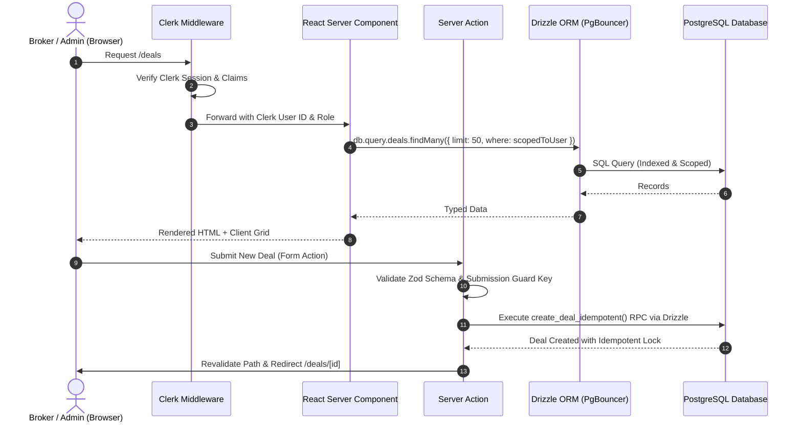
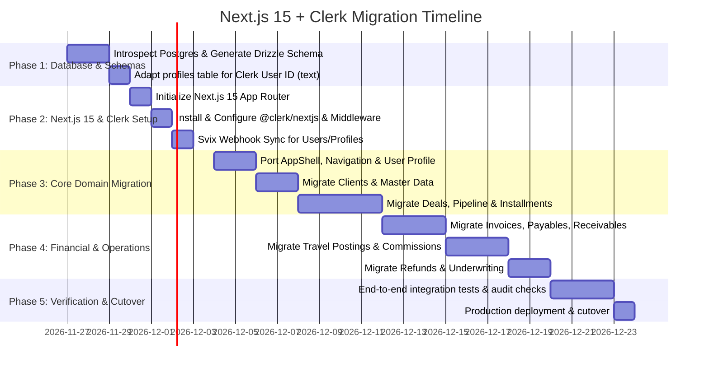

# Insurekar BMS — Next.js 15 Enterprise Conversion & Cleanup Blueprint

> **Executive Summary:** This document outlines the complete architectural rationale, migration path, and cleanup strategy to transform the current Lovable / TanStack Start prototype into a production-grade, high-volume **Next.js 15 (App Router) + Drizzle ORM + Clerk Auth + PostgreSQL** system.

---

## 1. Deep Technical Comparison: Next.js 15 vs. TanStack Start for an Insurance BMS

An Insurance Brokerage Management System (BMS) is not a simple marketing website or generic dashboard; it is a **mission-critical financial ledger, compliance record, and high-volume transaction processing engine**. Below is an in-depth breakdown of why Next.js 15 (App Router) is structurally superior to TanStack Start for this specific platform.

```
┌────────────────────────────────────────────────────────────────────────┐
│                   ARCHITECTURAL COMPARISON MATRIX                     │
├─────────────────────────┬──────────────────────┬───────────────────────┤
│ Dimension               │ TanStack Start       │ Next.js 15 App Router │
│                         │ (Current State)      │ (Target State)        │
├─────────────────────────┼──────────────────────┼───────────────────────┤
│ Framework Lifecycle     │ Alpha / Beta         │ Enterprise Production │
│ Authentication Layer    │ Supabase GoTrue Auth │ Clerk Enterprise Auth │
│ Data Fetching Model     │ Client PostgREST SDK │ React Server Comp.    │
│ Client Memory Footprint │ Heavy JSON hydration │ Lightweight HTML/RSC  │
│ Mutation Execution      │ Client + createServer│ Server Actions        │
│ Database Schema Layer   │ Raw SQL files only   │ Typed Drizzle ORM     │
│ Secrets & Service Role  │ High leakage risk    │ Server-only isolation │
│ Large File Streaming    │ In-browser (hangs)   │ Server stream buffers │
│ Hiring & Ecosystem      │ Niche / Experimental │ Global standard       │
└─────────────────────────┴──────────────────────┴───────────────────────┘
```

### 1.1 Production Maturity & Framework Stability (Alpha/Beta vs. Battle-Tested)
* **The Reality of TanStack Start Today:**
  * TanStack Start is in active **Alpha/Beta** (running `@tanstack/react-start: 1.168.60` alongside `nitro: 3.0.260603-beta`).
  * Framework APIs are actively shifting. During standard build execution, deprecation warnings appear (e.g., `createServerFn().inputValidator()` deprecated in favor of `validator()`).
  * Minor version updates frequently alter routing contracts, Vite plugins, and SSR hydration semantics.
* **Why Next.js is Essential for Insurance:**
  * Next.js 14 and 15 are battle-tested in Fortune 500 banks, healthcare institutions, and enterprise fintech platforms handling millions of daily transactions.
  * In an insurance brokerage handling premium collections, commission disbursements, and policy schedules, framework stability is a non-negotiable requirement.

### 1.2 Data Volume & The Client-Side Waterfall Problem
* **How TanStack Start Operates in This Codebase:**
  * Almost every screen fetches data **directly in the user's browser** via the Supabase client (`supabase.from('deals').select(...)`) inside `useEffect` or client hooks.
  * For 20 test deals, performance is acceptable. But at enterprise scale:
    * **10,000+ client profiles & contacts**
    * **50,000+ policies & endorsements**
    * **100,000+ installment rows & ledger entries**
  * The browser must download multi-megabyte JSON payloads, parse them in JavaScript memory, and execute sorting, filtering, and rollups on the end-user's device. On an agent's or broker's laptop in the field, this causes noticeable UI lag, tab freezes, and high battery consumption.
* **How Next.js Solves This (React Server Components - RSC):**
  * **Zero Client Waterfall:** Server Components run directly on the server next to the PostgreSQL database (connected via connection pooling).
  * Heavy joins (linking Clients $\rightarrow$ Deals $\rightarrow$ Installments $\rightarrow$ Invoices $\rightarrow$ Insurance Companies) execute in sub-millisecond database queries.
  * The browser receives **pre-rendered, lightweight HTML streams** with zero hydration overhead for static UI elements. Raw multi-megabyte JSON datasets never enter client memory.

### 1.3 Financial Ledger Integrity & Transaction Isolation
An insurance BMS is fundamentally an accounting system:
1. Deal submissions must be strictly **idempotent** (preventing accidental duplicate policies).
2. Installment collections must strictly obey **FIFO (First-In, First-Out)** reconciliation rules.
3. Commissions exceeding 45% must trigger auditable approval workflows.
4. Cancellations and refunds must atomically update the accounts ledger and receivables.

| Security & Mutation Dimension | Current TanStack Start Pattern | Next.js Server Actions Pattern |
| :--- | :--- | :--- |
| **Mutation Channel** | Client calls mixed with experimental `createServerFn` | Dedicated **Server Actions** (`"use server"`) |
| **Validation Layer** | Client-heavy Zod parsing that can be bypassed | Strict server boundary: invalid payloads never hit database triggers |
| **Cache Synchronization** | Manual query key invalidation with frequent stale-balance bugs | Automated `revalidatePath('/accounts/receivables')` ensures zero stale cache |
| **Secrets Isolation** | Service role key accidentally bundlable into client chunks | `server-only` package physically prevents server credentials from reaching client bundles |

### 1.4 High-Volume Document & Spreadsheet Streaming (Excel / PDF)
* **Current TanStack Start Approach:**
  * When exporting registers or reports, the browser downloads the entire `xlsx` library (~300KB) and builds the workbook in the browser thread. For registers with 5,000+ rows, the browser tab hangs.
* **Next.js Approach (Streaming Route Handlers):**
  * Dedicated streaming endpoints (`app/api/export/deals/route.ts`) stream database cursor rows directly into an HTTP response stream with `Content-Type: application/vnd.openxmlformats-officedocument.spreadsheetml.sheet`.
  * The file downloads instantaneously with virtually zero RAM consumption on either client or server.

### 1.5 TypeScript Schema Visibility with Drizzle ORM
* **Current Issue:**
  * The file `drizzle/schema.ts` is intentionally an empty placeholder in Lovable. The data model is scattered across 58 raw SQL migration files in `supabase/migrations/` and a 131KB auto-generated TypeScript file.
* **Next.js + Drizzle Solution:**
  * Clean, human-readable TypeScript schema definitions in `src/db/schema/*.ts`.
  * Every table, column type, enum, constraint, and foreign-key relation is explicitly declared, providing autocomplete, compile-time safety, and self-documenting data architecture.

---

## 2. Clerk Authentication Architecture & RBAC

Replacing Supabase Auth with **Clerk (`@clerk/nextjs`)** provides enterprise-grade identity, session management, and role-based access control (RBAC).

```
┌────────────────────────────────────────────────────────┐
│                   Clerk Auth Engine                    │
├────────────────────────────────────────────────────────┤
│  • Edge Middleware Protection (clerkMiddleware)        │
│  • Enterprise RBAC via publicMetadata (admin/mgmt/do)  │
│  • Automatic Session Expiry & Inactivity Timeout       │
│  • Multi-Factor Authentication (MFA / SMS / TOTP)      │
│  • Svix Webhook Sync -> PostgreSQL `profiles` table    │
└──────────────────────────┬─────────────────────────────┘
                           │
             Webhook Sync (Svix HMAC)
                           ▼
┌────────────────────────────────────────────────────────┐
│            PostgreSQL Database (Drizzle ORM)           │
│  `profiles.clerk_user_id` <--> `user_roles.role`       │
└────────────────────────────────────────────────────────┘
```

### 2.1 Role-Based Access Control (RBAC) via Clerk Metadata
Instead of making database round-trips to query roles on every page load, roles are stored directly in Clerk's `publicMetadata`:
```json
{
  "role": "admin", // "admin" | "management" | "team_lead" | "do"
  "team_id": "00000000-0000-0000-0000-000000000001"
}
```
In Next.js Server Components and Server Actions, the role is immediately available in the session claims:
```typescript
import { auth } from "@clerk/nextjs/server";

export async function assertAdmin() {
  const { sessionClaims } = await auth();
  const role = sessionClaims?.metadata?.role;
  if (role !== "admin") {
    throw new Error("Unauthorized: Super Admin access required");
  }
}
```

### 2.2 Edge Protection via Next.js Middleware
```typescript
// src/middleware.ts
import { clerkMiddleware, createRouteMatcher } from "@clerk/nextjs/server";

const isPublicRoute = createRouteMatcher([
  "/sign-in(.*)",
  "/sign-up(.*)",
  "/api/webhooks(.*)",
]);

const isAdminRoute = createRouteMatcher(["/admin(.*)"]);

export default clerkMiddleware(async (auth, req) => {
  if (!isPublicRoute(req)) {
    await auth.protect();
  }
  if (isAdminRoute(req)) {
    const { sessionClaims } = await auth();
    if (sessionClaims?.metadata?.role !== "admin") {
      return new Response("Forbidden", { status: 403 });
    }
  }
});

export const config = {
  matcher: ["/((?!.*\\..*|_next).*)", "/", "/(api|trpc)(.*)"],
};
```

---

## 3. Recommended Core Services to Strengthen Brokerage Calculations

To handle complex insurance brokerage calculations and high-volume ledger reconciliations, the following specialized libraries and engines are incorporated:

```
┌──────────────────────────────────────────────────────────────────────────────┐
│                    CORE BROKERAGE CALCULATION STACK                          │
├─────────────────────┬────────────────────────────────┬───────────────────────┤
│ Capability          │ Recommended Service / Library  │ Business Value        │
├─────────────────────┼────────────────────────────────┼───────────────────────┤
│ Financial Precision │ Decimal.js / Dinero.js         │ Zero IEEE float errors│
│ Background Jobs     │ Trigger.dev / Inngest          │ Month-end calculations│
│ Document PDF Engine │ @react-pdf/renderer            │ Debit Notes & Invoices│
│ Audit & Compliance  │ Axiom / Better Stack           │ Regulatory audit trail│
└─────────────────────┴────────────────────────────────┴───────────────────────┘
```

### 3.1 Arbitrary-Precision Financial Math (`Decimal.js` / `Dinero.js`)
* **Problem:** Native JavaScript numbers use binary floating-point (`IEEE 754`). Calculations like `0.1 + 0.2 = 0.30000000000000004` cause fractional rounding discrepancies across thousands of installment splits, causing ledger imbalances during bank audits.
* **Solution:** Integrate `decimal.js` inside Drizzle ORM queries and `src/lib/calc.ts` for:
  - Prorated cancellation refunds (exact day fractions $365/366$)
  - Multi-tier commission calculations (Gross vs. Net premium splits, 17% commission WHT, 9% marketing tax)
  - Currency rounding stored as exact fixed-precision `numeric(14, 2)` in PostgreSQL.

### 3.2 Async Background Job & Calculation Engine (`Trigger.dev` or `Inngest`)
* **Problem:** Standard serverless or HTTP requests time out after 10–30 seconds. Heavy brokerage operations cannot run safely in a standard web turn:
  - Re-evaluating 10,000 policies at month-end to calculate agent commissions and performance tiers.
  - Nightly automated sweeps to identify overdue installments and recalculate penalty/aging buckets.
  - Replaying FIFO payment allocation across historical accounts.
* **Solution:** Use **Trigger.dev v3** or **Inngest** directly in Next.js:
  - Executes long-running tasks (even multi-hour calculation jobs) without timing out.
  - Step-based execution: if step 4 fails, it retries step 4 without re-billing or duplicating steps 1–3.

### 3.3 Server-Side Debit Note & Invoice Generation (`@react-pdf/renderer`)
* **Problem:** Insurance brokers must generate official, print-ready documents:
  - Premium Debit Notes & Tax Invoices with provincial tax breakups (PRA/SRB/KPRA/FED).
  - Commission Payout Vouchers with approved signatures.
  - Policy Underwriting Slips.
* **Solution:** Use `@react-pdf/renderer` in a Next.js Route Handler (`/api/documents/debit-note/[id]`):
  - Stream PDFs directly to the broker or client as an HTTP stream.
  - Generates consistent, high-resolution PDFs with corporate letterheads and QR-code verification.

---

## 4. Target Directory & Clean Modular Structure

```
insurekar-bms/
├── src/
│   ├── app/                                 # Next.js 15 App Router
│   │   ├── (auth)/                          # Clerk authentication routes
│   │   │   ├── sign-in/[[...sign-in]]/page.tsx
│   │   │   ├── sign-up/[[...sign-up]]/page.tsx
│   │   │   └── layout.tsx
│   │   ├── (dashboard)/                     # Protected routes (AppShell + Guards)
│   │   │   ├── layout.tsx                   # Auth verification, Sidebar, Header
│   │   │   ├── page.tsx                     # Dashboard KPIs & Charts
│   │   │   ├── clients/
│   │   │   │   ├── page.tsx                 # Paginated Clients Table
│   │   │   │   └── [id]/page.tsx            # Client details & linked deals
│   │   │   ├── deals/
│   │   │   │   ├── page.tsx                 # Deals List View (Server Paginated)
│   │   │   │   ├── new/page.tsx             # New Deal Creation (Idempotent Guard)
│   │   │   │   ├── [id]/page.tsx            # Deal Master Record & Editor
│   │   │   │   └── pipeline/page.tsx        # Pipeline Kanban & Funnel
│   │   │   ├── accounts/
│   │   │   │   ├── invoices/page.tsx
│   │   │   │   ├── receivables/page.tsx
│   │   │   │   ├── payables/page.tsx
│   │   │   │   ├── installments/page.tsx
│   │   │   │   ├── payments/page.tsx
│   │   │   │   ├── tax/page.tsx
│   │   │   │   └── approvals/page.tsx
│   │   │   ├── operations/
│   │   │   │   ├── commissions/page.tsx
│   │   │   │   ├── refunds/page.tsx
│   │   │   │   ├── underwriting/
│   │   │   │   │   ├── page.tsx
│   │   │   │   │   ├── new/page.tsx
│   │   │   │   │   └── [id]/page.tsx
│   │   │   │   ├── travel/page.tsx          # Bulk policies & delivery tracking
│   │   │   │   ├── dispatch/page.tsx
│   │   │   │   └── payroll/page.tsx
│   │   │   ├── tickets/
│   │   │   │   ├── page.tsx
│   │   │   │   └── [id]/page.tsx
│   │   │   └── admin/                       # Super Admin only
│   │   │       ├── users/page.tsx
│   │   │       ├── teams/page.tsx
│   │   │       ├── master-data/page.tsx     # Insurers, stages, sources
│   │   │       └── targets/page.tsx
│   │   ├── api/                             # Streaming endpoints & webhooks
│   │   │   ├── webhooks/clerk/route.ts      # Svix Webhook user sync
│   │   │   ├── export/deals/route.ts        # Server-side Excel streaming
│   │   │   ├── documents/invoice/[id]/route.ts # Server-side PDF generation
│   │   │   └── webhooks/route.ts
│   │   ├── globals.css
│   │   └── layout.tsx                       # Root layout (<ClerkProvider>, Fonts, Toaster)
│   │
│   ├── actions/                             # Next.js Server Actions (Type-safe mutations)
│   │   ├── deals.actions.ts                 # Create (idempotent), update, correct
│   │   ├── clients.actions.ts               # Create, update (delta-only)
│   │   ├── accounts.actions.ts              # Invoicing, receipts, payment allocation
│   │   ├── operations.actions.ts            # Commission approval, refunds, travel
│   │   └── admin.actions.ts                 # User provisioning, lock, team assignment
│   │
│   ├── jobs/                                # Trigger.dev / Inngest Background Jobs
│   │   ├── monthly-commissions.job.ts       # Nightly & month-end commission batch runs
│   │   └── overdue-installments.job.ts      # Daily overdue checks & aging sweeps
│   │
│   ├── db/                                  # Drizzle ORM Database Layer
│   │   ├── index.ts                         # Pooled PostgreSQL client
│   │   ├── schema/                          # Explicit TypeScript Schemas
│   │   │   ├── auth.ts                      # Profiles (linked to Clerk ID), roles
│   │   │   ├── clients.ts                   # Clients & client contacts
│   │   │   ├── deals.ts                     # Deals, stages, custom installments
│   │   │   ├── accounts.ts                  # Invoices, payables, receivables, ledger
│   │   │   ├── operations.ts                # Travel postings, refunds, underwriting
│   │   │   ├── master.ts                    # Companies, insurance types, sources
│   │   │   └── index.ts                     # Schema barrel export
│   │   └── relations.ts                     # Full foreign-key relational graph
│   │
│   ├── components/                          # UI Component Tree
│   │   ├── ui/                              # shadcn/ui components (Radix + Tailwind)
│   │   ├── shared/                          # PageHeader, MoneyInput, DateField
│   │   ├── deals/                           # DealAmountTable, DealCustomInstalments
│   │   ├── accounts/                        # InvoiceTable, PaymentAllocationModal
│   │   └── layout/                          # AppShell, Sidebar, Header, UserMenu
│   │
│   ├── lib/                                 # Pure Business Logic & Domain Engines
│   │   ├── calc.ts                          # Financial calculations (100% preserved)
│   │   ├── deal-record-fields.ts            # Explicit catalog for deal corrections
│   │   ├── deal-instalment-rollup.ts        # Rolled-up sums and balances
│   │   ├── permissions.ts                   # Role permission matrices
│   │   └── format.ts                        # Currency, date, and text formatters
│   │
│   └── middleware.ts                        # Clerk edge protection & route matchers
```

---

## 5. How Features Will Work in Next.js + Clerk



### Module by Module Execution Details:

#### 1. Authentication & Role Permissions
- **How it works:** 
  - Handled via `@clerk/nextjs` with `clerkMiddleware()`.
  - Roles (`admin`, `management`, `team_lead`, `do`) are assigned via Clerk `publicMetadata` and synchronized with the database `user_roles` table via webhooks.
  - Admin-only routes (`/admin/*`) and actions verify `sessionClaims.metadata.role === 'admin'`.

#### 2. Deals Engine & Pipeline
- **How it works:**
  - **Idempotent Creation**: Submissions use a unique per-attempt submission key passed to the PostgreSQL RPC `create_deal_idempotent`. Double clicks or network retries safely return the existing deal without duplicating rows.
  - **Correction Controls**: Editing existing deals uses the explicit schema field catalog (`src/lib/deal-record-fields.ts`), strictly excluding financial totals and audit identities.
  - **Installment Rollups**: Handled by the pure calculation engine (`src/lib/deal-instalment-rollup.ts`), keeping client balances synchronized with database triggers.

#### 3. Accounts & Financial Reconciliation
- **How it works:**
  - Invoices, receivables, and payables are fetched via server pagination (50/100 rows per page with search and date filters).
  - Payment corrections and receipts trigger the PostgreSQL FIFO allocation trigger, automatically prioritizing specific installments and rejecting mixed manual balances.
  - Tax withholding calculations are computed via `src/lib/calc.ts`.

#### 4. Operations & Travel Postings
- **How it works:**
  - Bulk travel policy uploads are parsed via streaming server actions, writing directly into `travel_postings` and `travel_posting_rows`.
  - Delivery tracking (Sent/Unsent status) is kept in its dedicated role-restricted table.
  - Policies with commission $>45\%$ automatically flag `commission_approval = 'pending'`, notifying Admins.

#### 5. Refunds Engine
- **How it works:**
  - Enforced via database security functions `refund_allows()` and `can_see_refund()`.
  - Internal remarks live in a separate, permission-gated table.
  - Documents upload to private storage buckets using pre-signed upload URLs generated on the server.

---

## 6. Code Cleanup & De-cluttering Strategy

### What Gets Deleted / Removed:
1. **Lovable Wrappers**:
   - Delete `@lovable.dev/cloud-auth-js`
   - Delete `@lovable.dev/vite-tanstack-config`
   - Delete `src/lib/lovable-error-reporting.ts`
2. **Supabase Client Auth Redundancies**:
   - Delete `src/lib/auth.tsx` (Replaced by Clerk's `useAuth()`, `useUser()`, and `<ClerkProvider>`)
   - Delete `src/components/SessionTimeout.tsx` (Handled natively by Clerk)
   - Delete `src/integrations/supabase/previewAuthStorage.ts`
3. **TanStack Start & Nitro Engine**:
   - Delete `nitro`, `@tanstack/react-start`, `@tanstack/router-plugin`, `@tanstack/react-router`
   - Delete `vite.config.ts`, `bun.lock`, `bunfig.toml`
   - Delete flat route files in `src/routes/*`
4. **Obsolete Configs**:
   - Delete `components.json` (replaced with standard Next.js shadcn config)
   - Clean up `package.json` to remove 25+ unused development and bundler packages.

### What Gets Reused & Preserved (Zero Loss of Work):
1. **Domain Logic (`src/lib/`)**:
   - `src/lib/calc.ts` (Commission & financial formulas)
   - `src/lib/deal-record-fields.ts` (Validation & field schemas)
   - `src/lib/deal-instalment-rollup.ts`
   - `src/lib/format.ts`
   - `src/lib/permissions.ts`
2. **UI Component Primitives (`src/components/ui/`)**:
   - All 40+ Radix/Tailwind components (`button.tsx`, `dialog.tsx`, `input.tsx`, `table.tsx`, `select.tsx`, etc.) are 100% compatible with Next.js 15.
3. **Business Components**:
   - `DealAmountTable.tsx`, `DealCustomInstalments.tsx`, `MoneyInput.tsx`, `DateField.tsx`, `PipelineKanban.tsx` transfer directly to Next.js Client Components (`"use client"`).
4. **PostgreSQL Database**:
   - All 58 migrations, tables, triggers, RPC functions, and accounting triggers remain completely preserved.

---

## 7. High-Volume Scalability Blueprint

To ensure the platform seamlessly handles thousands of clients, policies, and transactions:

### 1. Database Connection Pooling
- Next.js connects through PostgreSQL's **Supavisor / PgBouncer Transaction Pooler** (Port `6543`).
- Eliminates connection exhaustion during high concurrent load.

### 2. Server-Side Pagination & Cursor Streaming
- No table loads unfiltered datasets into the browser.
- All list endpoints (`/deals`, `/clients`, `/accounts/invoices`) implement:
  ```typescript
  const records = await db.query.deals.findMany({
    where: and(eq(deals.team_id, userTeamId), inArray(deals.stage_id, selectedStages)),
    limit: 50,
    offset: (page - 1) * 50,
    orderBy: [desc(deals.created_at)],
  });
  ```

### 3. Database Indexing Strategy
Ensure compound indexes exist on:
- `deals(team_id, created_at DESC)`
- `deals(client_id, stage_id)`
- `deal_installments(deal_id, status, due_date)`
- `invoices(client_id, status)`
- `travel_postings(created_at DESC)`

---

## 8. Phased Execution Roadmap


